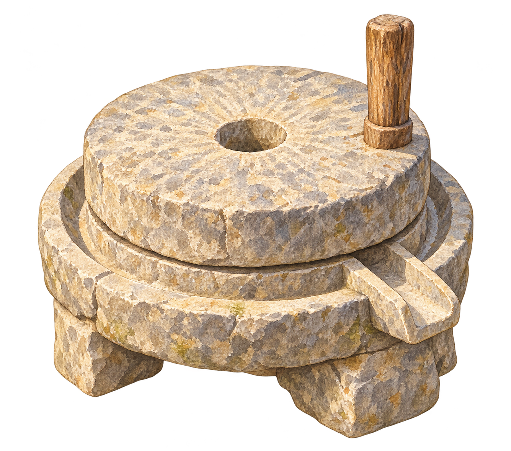

# #700 出生磨盘原画候选 v1

Owner / 作者：**CODEX-LEAD**，2026-10-13。关联 [成长主线 #700](https://github.com/narutojzm1-dot/youjia/issues/700)。

**仅资源归档候选；未经场景验收、未接入、未上线。禁止生产运行引用本目录。** `.gdignore` 保持 Godot 扫描隔离；本次不增加资源注册、导入配置、场景摆放、磨粉逻辑、存档字段、UI、公告或发布变更。

## 来源与文件

当前仓库中未找到已有磨盘图或通过验收的可复用磨盘资源；找到的是成长策划中的磨盘规划，文件名 `millet` 的搜索命中不属于磨盘。

使用 **内置 image_gen.imagegen** 制作，非 CLI，透明背景。主要参考现行小院晴天原画的绘本水彩、石材和视角，次要参考实体背篓的独立物件呈现；两张参考图未改动，也没有把磨盘画入背景。用户已授权 #700 出生磨盘资源，Leader 指定本资源切片。没有下载外部第三方素材。

- `millstone-watercolor-v1.png`：原始生成 PNG 的逐字节副本，1335×1178 RGBA，2,358,584 字节。
- 源图 SHA-256：`a9248478d8cea22d8244e355b72d71c860a7e4330f3154e844965192b6086f64`。
- `prompt-v1.txt`：完整原始提示词。
- `source-metadata.json`：生成文件标识、来源/参考图/提示词哈希、alpha 统计、目视结果和未覆盖范围。
- `archive-manifest.json`：目录清单及双哈希，排除清单自身。

未重采样、抠图、改透明度、压缩重编码或手工补画；保留源图作者与生成记录。归档路径选在 `docs/candidates/`，因为现有 Verify/Publish 工作流只排除 `docs/**` 与根 README；正式 assets 目录变化会触发完整游戏验证/发布。此隔离归档经 Leader 明确授权，后续正式接入必须另行验证。

## 审画状态与限制

独立源图已目视，Leader 也已查看：上下石盘、中心进料孔、木柄和前右出粉口清楚，风格可以作为待接入候选。原分辨率颗粒偏重，需要实际缩放审画；没有据此标记美术通过。

透明数据原样保留：多数主体像素 alpha 为 252/253，而非完全不透明 255；外围有极淡 alpha 1 像素。alpha >16 的主体 bbox 为 `[98,37,1238,1145]`，可见主体留有余量。完整 alpha bbox `[0,15,1315,1178]` 包含微弱边缘；未手动修补。接入前须检查真实背景下的透明边缘、纹理强度、比例/视角、接地和遮挡。

没有场景/GPU/Web/手机验收，没有正式 PCK 体积测量或运行出粉表现。磨盘场景位置仍未决定，不占用用户指定的家门左侧铁铲/铁锄工具位置。后续生产目录可按独立接入 PR 确定，不能因候选归档而自动放行。

Leader 继续负责最终审画、模型/接口和运行接入。本片不接管 ASSISTANT 近郊农田或 CURSOR-CLOUD UI，不改变食材/AP/经验/配方规则，不关闭 #700。
