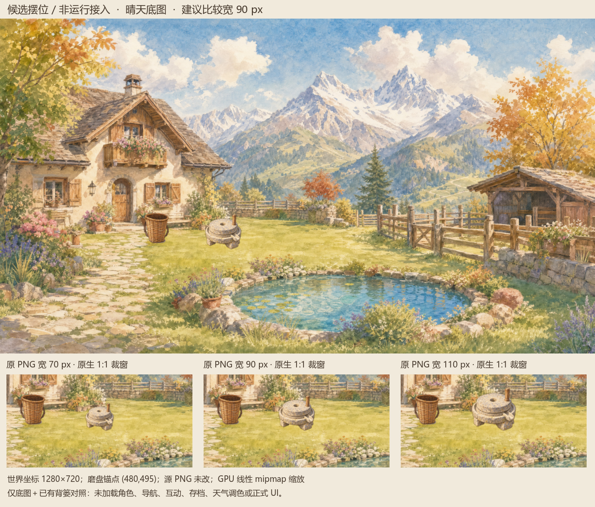
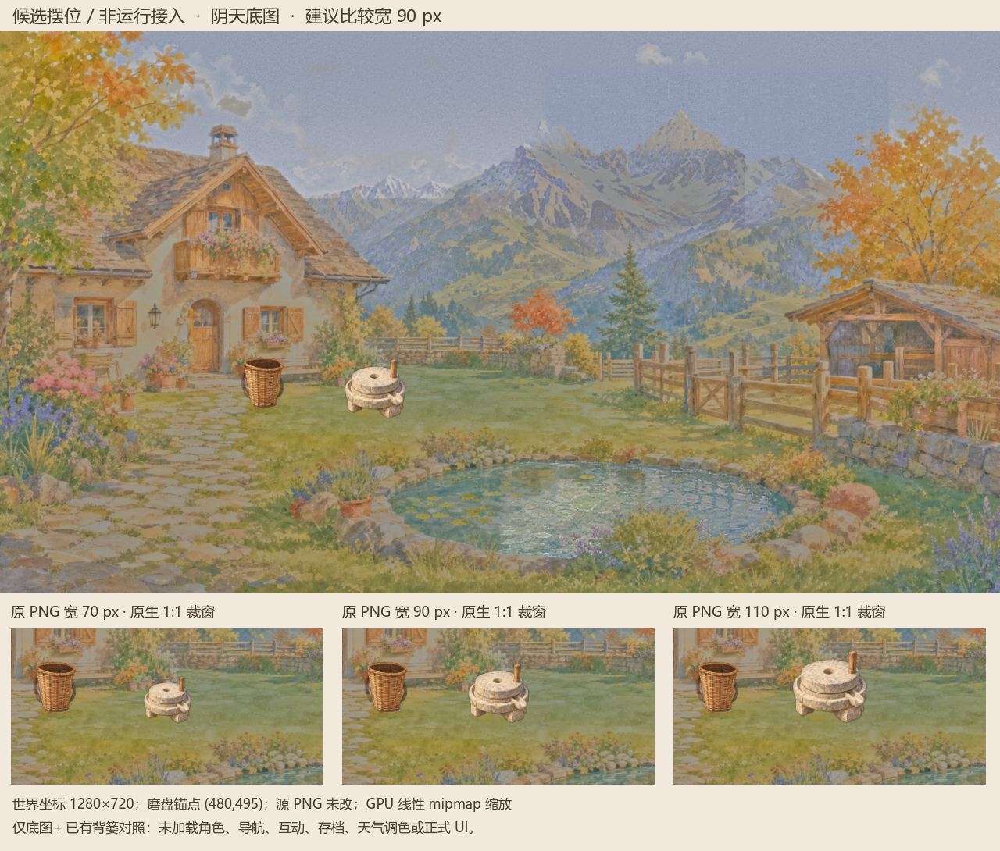

# #700 磨盘候选摆位 GPU 预览

CODEX-LEAD，2026-10-13。**候选摆位 / 非运行接入**。两图来自独立 Godot 4.7.2 / OpenGL Compatibility / RTX 4070 Laptop GPU 临时场景，并非普通玩家截图或最终场景验收。





两张 1280×1090 PNG 保持原始 GPU 输出字节。上方院景按 1280×720 世界尺寸呈现，下方三窗是同处 70/90/110 px 源画布宽度的 1:1 GPU 裁窗；参照背篓沿用 (335,485)、70 px 高。磨盘锚点 (480,495)，源支点 (667.5,1145)；90 px 画布宽对应 alpha >16 主体约 76.9 px。原 PNG 未改，线性 mipmap 只在内存生成。

70 px 的出粉槽偏小，90 px 结构清楚，110 px 较抢眼。晴天缩小后颗粒缓和；阴天原色偏亮偏暖，仍需既有天气调色后的实际场景审查，脚底接地感仍较轻。候选位置视觉上避开门、门左工具位、背篓和三组原花草；没有运行角色、导航、碰撞、互动、存档、成长、天气调色或正式 UI，不把位置建议当成可达验证。

## 文件与复现

`capture-summary.json` 记录源资源相对路径、哈希、设备、布局和限制。`source-provenance.json` 保留实际捕获时脚本及日志的原始 SHA-256；归档脚本仅增加输入参数和防覆盖检查，渲染逻辑保持。原 stdout 含本机路径，公开日志仅将两处输出目录替换为 `<OUTPUT_DIR>`，其余字节不变，**不冒称公开日志为原字节**；空 stderr 保持原字节。原图、来源和完整生成 prompt 见[上级候选目录](../README.md)。

复现需带图形设备的 Godot 4.7.2。把本目录 `capture.gd` 与 `project.godot` 复制到独立临时工程，使用独立 APPDATA；不要对生产工程执行。示例中的三个绝对路径由执行者传入，输出必须是仓库外新目录：

```text
godot --path <TEMP_PROJECT> --script capture.gd --rendering-method gl_compatibility --audio-driver Dummy -- --repo-root <ABS_CHECKOUT> --output-dir <ABS_NEW_TEMP_OUTPUT>
```

可用 `--source-png <ABS_PNG>` 明确输入图；默认读取仓库 `docs/candidates/millstone_v1/millstone-watercolor-v1.png`。真实捕获字体为 Microsoft YaHei；其他系统可用 `--font-family` 指定中文字体，但字形及 GPU 差异可能影响新截图像素，不冒称跨设备逐字节一致。本次归档没有重新演出或替换截图。

本目录及上级 `.gdignore` 禁止 Godot 自动扫描，未被运行代码引用。`archive-manifest.json` 排除自身，只收本目录证据，不收缓存或私人路径。此 PR 仅归档，未新生成图片，未接入、未发布，不改变配方、位置或产品规则。

**Leader 已查看两图，接受 90 px / (480,495) 作为待实际接入验证起点；阴天未调色和脚底较轻的限制保留。这不是最终美术、普通 Web、设备或玩法验收通过。**
