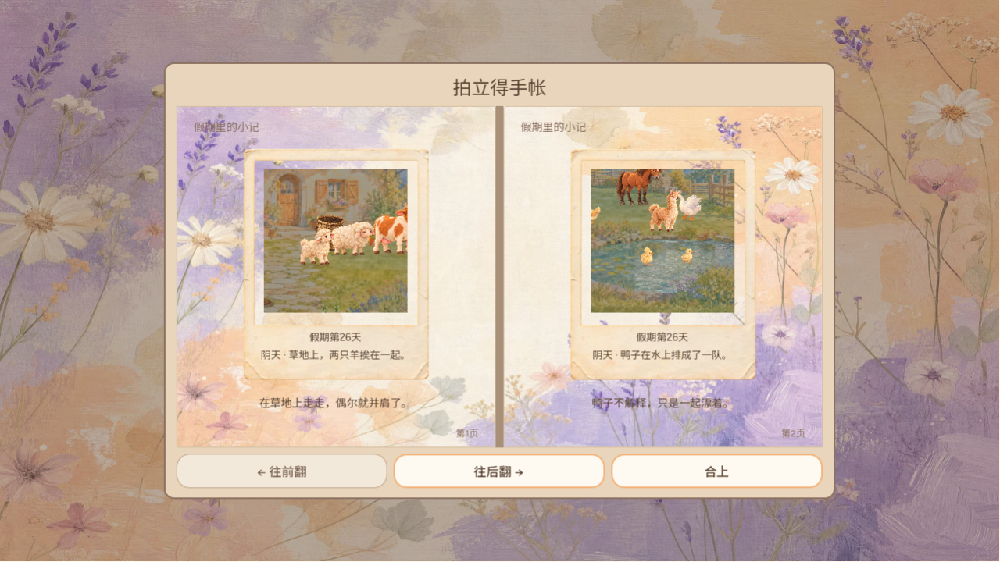
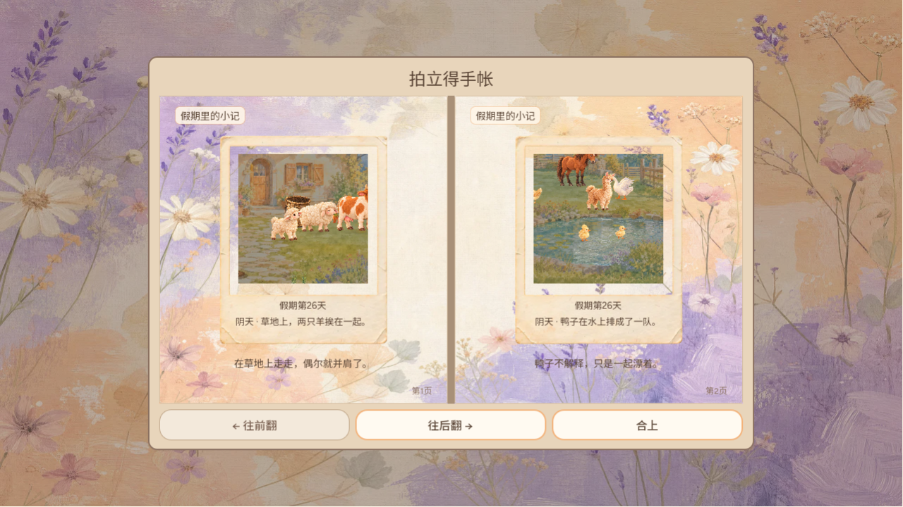
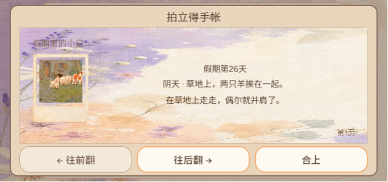
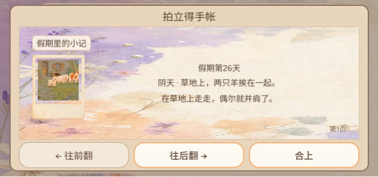
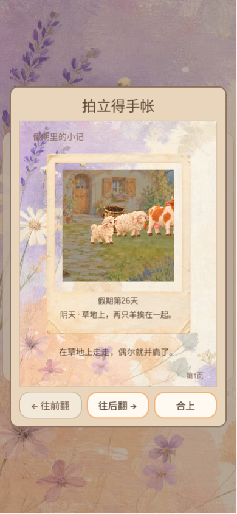
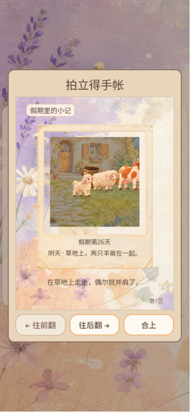
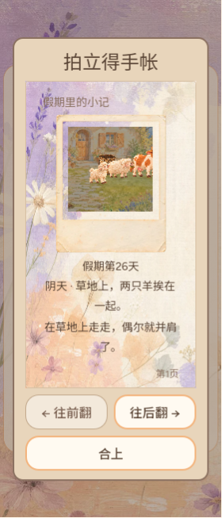
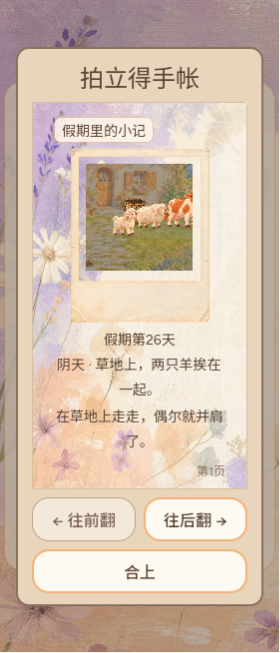

# 相册页眉「假期里的小记」垫纸签（CURSOR-CLOUD UI 维护）

## 问题

相册每页左上的「假期里的小记」原来是 14 号 MUTED（`#8a7060`）字，直接压在相纸背景上。背景左上角正好有薰衣草枝，Web 实玩时枝条从字中间划过，小屏上几乎读不出来。即便落在纯纸色上，MUTED 对 PAPER 的对比度也只有 4.29:1，不到正文 4.5:1 的要求。

## 改动

- `scripts/main.gd` `_album_page`：页眉字号不变（14 号），字色改为 INK（对 PAPER 8.25:1），垫一张 88% 不透明的小纸签（杏色细边、圆角 6、左右 8px/上下 2px 内边距），宽度只包住文字（`SIZE_SHRINK_BEGIN`）。
- 正文高度扣掉纸签上下内边距，书页总高不变。
- 不碰 #720 在改的 `_show_album`、`_flip_album`、`_toggle_pause`、`_show_basket`。

## 回归

`test/album_layout_suite.gd` 新增 `_check_heading`：在全部视口、全部页上检查页眉纸签不透明度 ≥ 0.85、字色对纸签对比度 ≥ 4.5、纸签宽度不超过文字所需。main 原代码在这些检查上失败 1440 项。改后结果：album_layout 90076 项通过，album_short_landscape 57869 项通过，album_caption_fit 14729 项通过。

## Web 实玩证据

本地 Web 导出、带照片的存档（第 31 天）。前图来自 #746 合入前后的构建，后图来自本分支。

| 视口 | 改前 | 改后 |
| --- | --- | --- |
| 1280×720 |  |  |
| 640×300 |  |  |
| 390×844 |  |  |
| 280×653 |  |  |

改后页眉在四个视口都落在纸签上，枝条不再穿过文字。

## 已知限制

- 纸签只用于页眉，页脚「第N页」仍是原样式（落在纸色区域，未见遮挡）。
- 当前版本固定中文；英文页眉更长，纸签会随文字变宽，套件同样覆盖。
