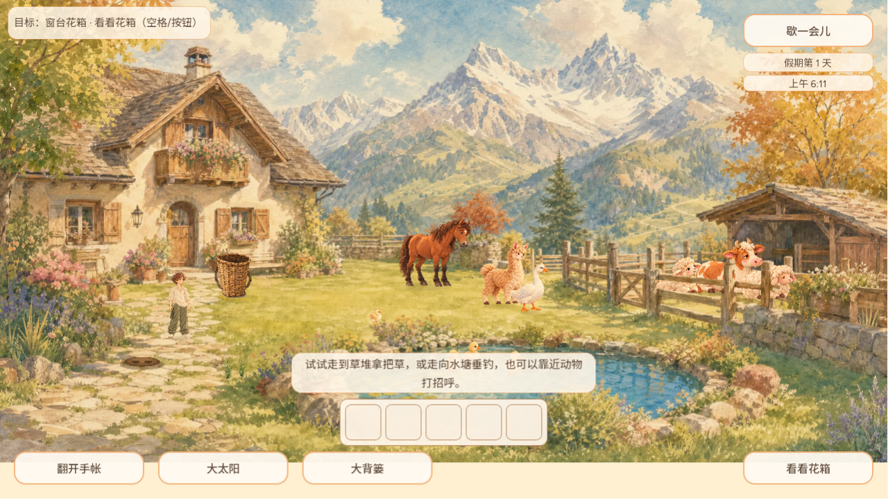
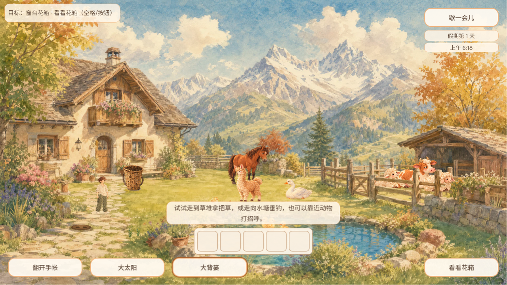
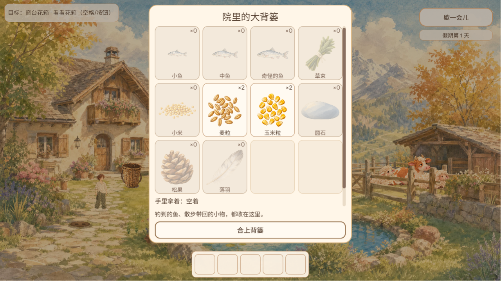
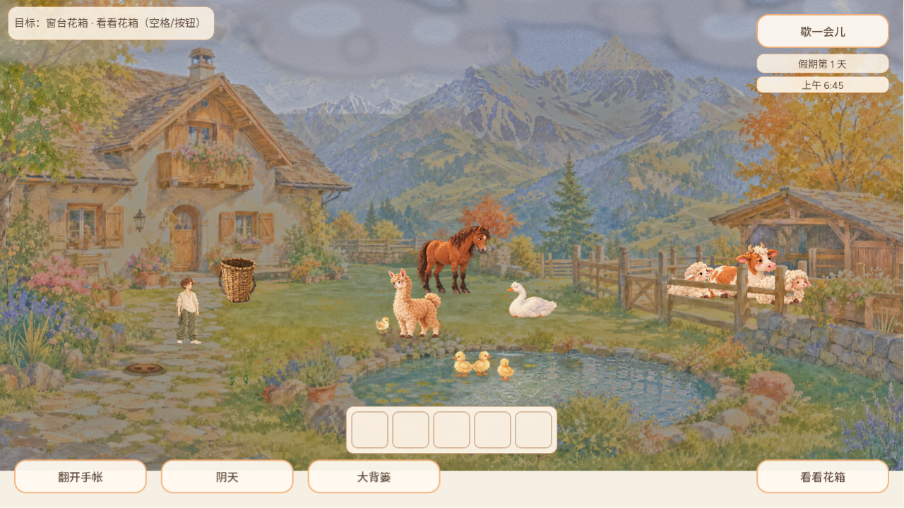

# 院内 Tab 轮转底栏按钮（CURSOR-CLOUD UI 维护）

## 问题

接续 #756（菜单纯键盘焦点）。在小院里，纯键盘玩家只能用 WASD/方向键走路、空格互动、Esc 暂停，打不开「翻开手帐」「大背篓」，也切不了天气。底栏这几枚按钮故意设成 `FOCUS_NONE`：一是鼠标点过按钮后空格仍要是互动，二是 Web 上的点击由 `_input` 手动命中。结果这几枚按钮键盘完全够不着。

## 改动

- `scripts/main.gd` 的 `_input` 在院内分支加了以下几条：
  - Tab / Shift+Tab 在可见按钮间轮转：翻开手帐 → 天气 → 大背篓 → 行动 → 歇一会儿。被纸面盖住而隐去的按钮会跳过。
  - 只有轮到的那一枚按钮临时设为 `FOCUS_ALL`，并显示原有的焦点描边。
  - 有按钮被选中时，回车/空格按下它。
  - 方向键、WASD、鼠标或触屏任一操作都会放下焦点，按钮一失焦就恢复 `FOCUS_NONE`，之后空格仍是互动。
- 新增 `_hud_keyboard_buttons`、`_hud_keyboard_focus`、`_cycle_hud_focus`、`_on_hud_button_focus_exited`。
- 不改 `_build_hud`，也不改 #720 的 `_show_album`、`_flip_album`、`_toggle_pause`、`_show_basket`。
- 打开的纸面（背篓、相册、暂停）照旧接管焦点；相册和暂停沿用 #756 的“第一次按键选中默认按钮”。

## 回归

新增 `test/hud_keyboard_focus_suite.gd`（HUD_KEYBOARD_FOCUS），在 1280×720、390×844、640×300 三个视口检查：

- 小院开始时没有焦点。
- Tab 依次走过所有可见按钮并循环，每次只有被选中的那枚可聚焦，且焦点描边可见；Shift+Tab 反向。
- 走路键放下焦点。
- 回车开背篓、空格开手帐、回车切天气，歇一会儿打开暂停。关掉纸面后按钮恢复不可聚焦。
- 点击放下焦点，之后空格是互动，不会按到按钮。

改后 234 项全过，main 原代码失败 69 项。

`menu_keyboard_focus_suite` 原来断言“院内 Tab 不选中 HUD 按钮”，现在改为 Tab 选中「翻开手帐」、方向键放下焦点，207 项全过。两个套件都已登记进 verify 和 completions 表。

## Web 实玩证据

本地 Web 导出，Chrome 1280×720，全程只用键盘（标题页 Tab、回车进院）。改前截图来自 main。

| 场景 | 截图 |
| --- | --- |
| 改前：院内按 Tab，底栏没有任何按钮被选中 |  |
| 改后：Tab 选中「翻开手帐」 |  |
| 改后：再按两次 Tab 到「大背篓」 |  |
| 改后：回车打开大背篓 |  |
| 改后：Esc 关背篓，Tab 到天气，回车切成阴天，焦点留着可再按 |  |
| 改后：按 D 走路，焦点描边消失 |  |

## 已知限制

- 手持快捷栏的格子仍不在 Tab 轮转里。
- 近郊画卷照旧用 R/E/T 和空格。
- 标题页的操作提示没有写 Tab；是否改文案留待以后统一调整提示。
