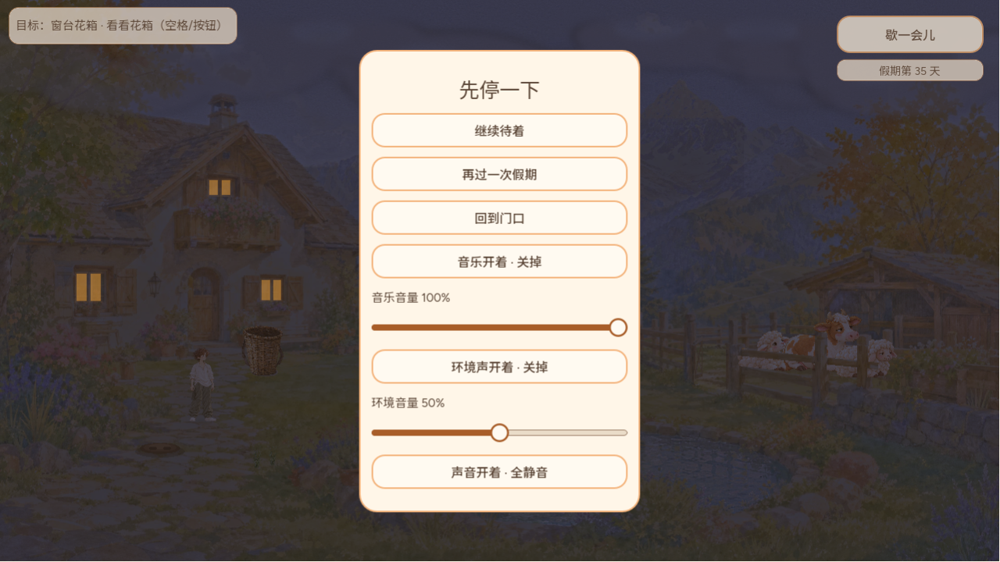
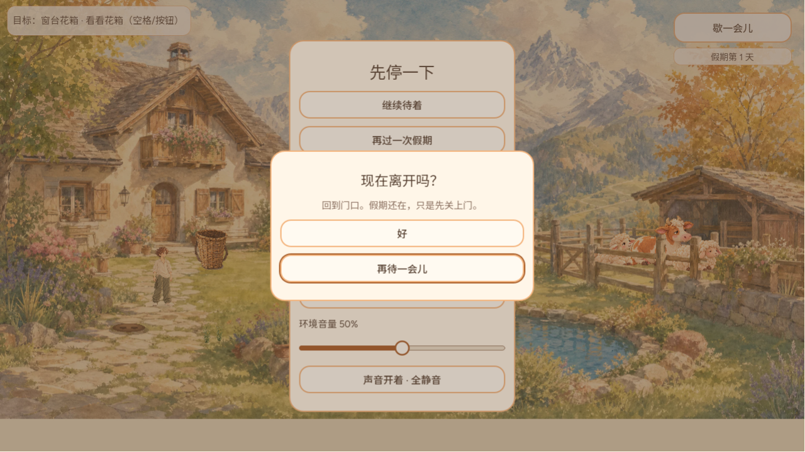
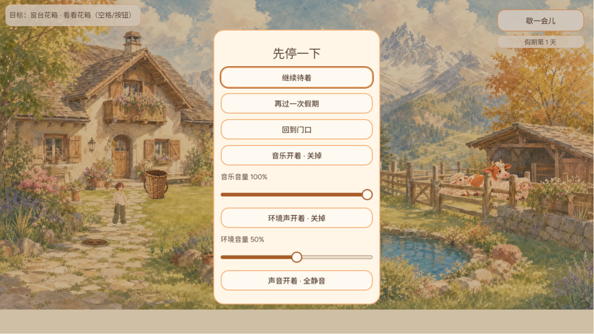
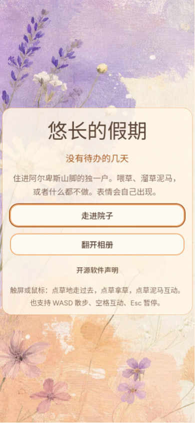

# 菜单纯键盘可操作：第一次按键选中默认按钮（CURSOR-CLOUD UI 维护）

## 问题

GAME-QA 10 月 11 日 20 点报告把“全键盘路径”列为输入/UI 缺口。CURSOR-CLOUD 用 Web 导出（main `14e38fb4`）只按键盘走了一遍：

- 标题页按 Tab、Shift+Tab、上下方向键、回车、空格，画面像素完全不变，进不了小院。标题页提示写着“也支持 WASD 散步、空格互动、Esc 暂停”，但玩家首先就卡在标题页。
- 在小院按 Esc 能打开暂停，但 Tab 和方向键同样没有任何反应。

原因：标题、暂停、确认和相册打开时没有任何按钮拿着焦点。Godot 4.7 在无焦点时不会因 Tab 或方向键自动选中按钮。按钮本身是 `FOCUS_ALL`，也有可见的焦点描边，只是从来没被选中过。`_play_button.grab_focus()` 是 9 月 30 日整体重写时一并丢掉的，不是有意取消。

## 改动

- `scripts/main.gd` 在 `_input` 加一层兜底 `_focus_menu_default`：标题、暂停、确认或相册打开，且焦点不在最上层菜单里时，第一次按 Tab、Shift+Tab、上、下、回车或空格，只把焦点交给该界面的默认按钮。默认按钮分别是「走进院子」「继续待着」、确认框的安全选项（「再待一会儿」/「算了」）和「合上」。之后的移动和按下由 Godot 正常处理。
- 打开菜单本身不抢焦点，所以只用鼠标或触屏的玩家不会凭空看到焦点框。
- 确认框弹出时，焦点还留在被盖住的暂停按钮上；下一次按键会把焦点移到确认框里，不在被遮住的按钮间乱走。
- 相册的左右键仍归翻页；游戏中回车仍是互动，方向键仍是走路。
- 不改 #720 正在动的 `_show_album`、`_flip_album`、`_toggle_pause`、`_show_basket`。

## 回归

新增 `test/menu_keyboard_focus_suite.gd`（MENU_KEYBOARD_FOCUS），在 1280×720、390×844、640×300 三个视口检查以下几点：

- 打开菜单时不抢焦点；五种导航键的第一下都只选中默认按钮，不触发按钮。
- Tab 不越出最上层菜单，并能走到标题页的三个按钮。
- 回车能开始假期、打开确认框、按「算了」返回暂停、继续游戏、打开和合上相册。
- 游戏中 Tab 和方向键不会让 HUD 拿到焦点。

改后 204 项全过，main 原代码失败 141 项。已登记进 `tools/verify_daily_life.sh` 和 `tools/lib/godot_suite_completions.tsv`。另外 16 个输入、菜单和相册相关套件全部通过。

## Web 实玩证据

本地 Web 导出，Chrome。改前截图来自 main `14e38fb4`，改后来自本分支，全程只用键盘。

| 场景 | 截图 |
| --- | --- |
| 改前：标题页按两次 Tab，无变化 |  |
| 改前：暂停里按 Tab，无变化 |  |
| 改后：标题页按 Tab，「走进院子」出现焦点描边；随后回车进了小院 |  |
| 改后：Esc 暂停，按下方向键选中「继续待着」 |  |
| 改后：选「回到门口」回车，确认框里按 Tab 选中「再待一会儿」 |  |
| 改后：回车「再待一会儿」，再按上方向键回到「继续待着」 |  |
| 改后：390×844 竖屏标题页按 Tab |  |

## 已知限制

- 小鸡成长、种植、背篓三张纸面有各自的焦点处理，本次不改。
- 按「算了」关掉确认框后，焦点回到「继续待着」，不是原来按的那个按钮。
- 实体手柄未实测，套件只覆盖键盘。
