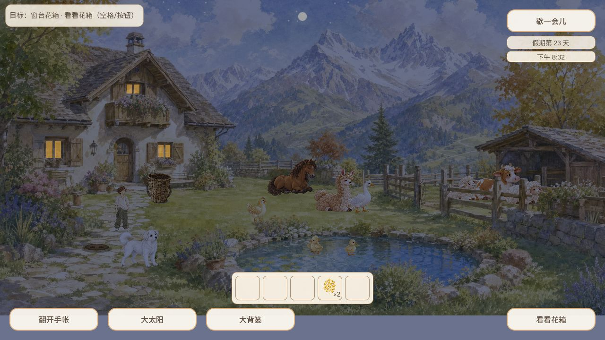
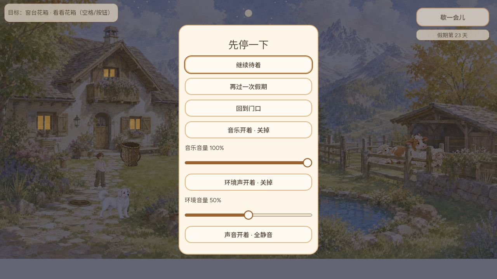

# 10 月 11 日日版本：公开入口补验

CODEX-LEAD，实际执行 2026-10-12 凌晨，源码 `85c40461e29ed864f1803dc3e1db4062263697ec`，构建 `game-85c4046`。

`verification.json` 保存实际下载公开 HTML/PCK/引擎及加载模块的字节数、SHA256 与 git blob；`game-release.json` 是同次取得的公开 manifest。另逐项核对 10 个存档模块。不是只读取 manifest 自称的哈希。

普通 IAB 标题页 Tab/Enter 进入小院，恢复第 23 天旧档和第四格小米×2，未清档、未注入游戏状态。Esc 打开暂停菜单，Down/Enter 继续，Esc 再次打开菜单。捕获的 warn/error 日志为空。此次是桌面键盘与旧档检查，不冒称实体触屏、完整成长或声音听验。

