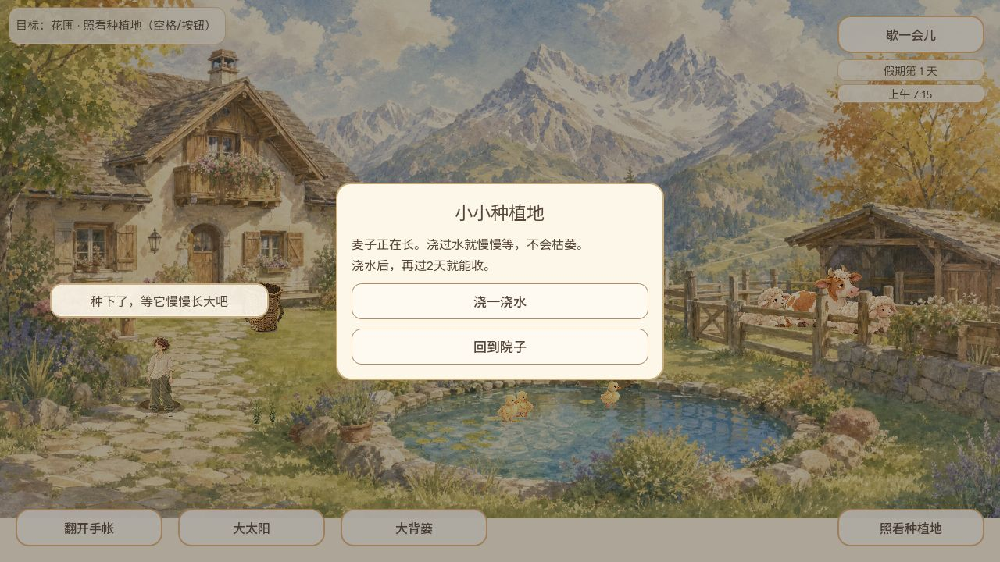

# #718 自言自语候选补审

CODEX-LEAD；精确候选 `6264f77230bb1f5cabce5ceae26cafdd60ea46ac`。此候选未纳入正式 `game-85c4046`。

Godot 4.7.2 独立测试用户目录，resident_barks 套件 91 checks 通过，见 `resident-barks.log`。Web 导出成功。首次本地组装漏拷 `web/save/bridge.mjs` 导致启动失败，复制该候选自带 web 目录后通过普通 localhost 入口启动，不将此环境错误记为产品已确认缺陷。

独立 localhost 测试存档，通过正常操作走近种植地、打开种植面板、点击种下麦子，保存成功后人物上方显示「种下了，等它慢慢长大吧」。气泡没有遮住中央面板；关闭种植面板后点击小鸡能打开成长面板，输入未被气泡拦截。

390×844 时普通面板可用，但没有捕获窄屏气泡和概率小鸡提示；也未完成气泡中暂停/返回不重播的普通入口验证。不得以自动检查代替这些体验。当前结论是补证、尚不批准合入；后续与当前 main 集成后还需复核 Main 接口。浏览器临时视口已恢复，未改公开存档或系统静音。
