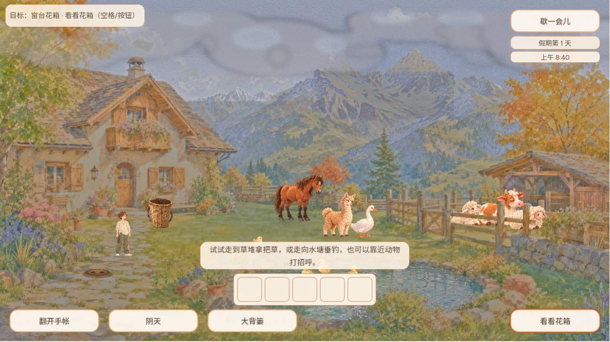
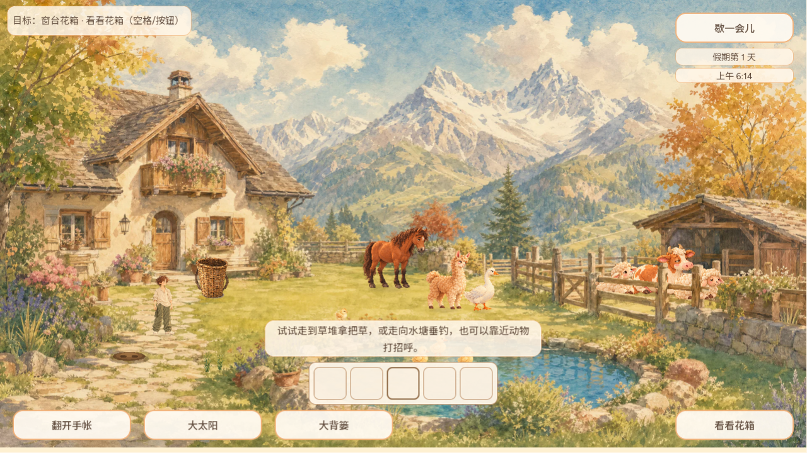
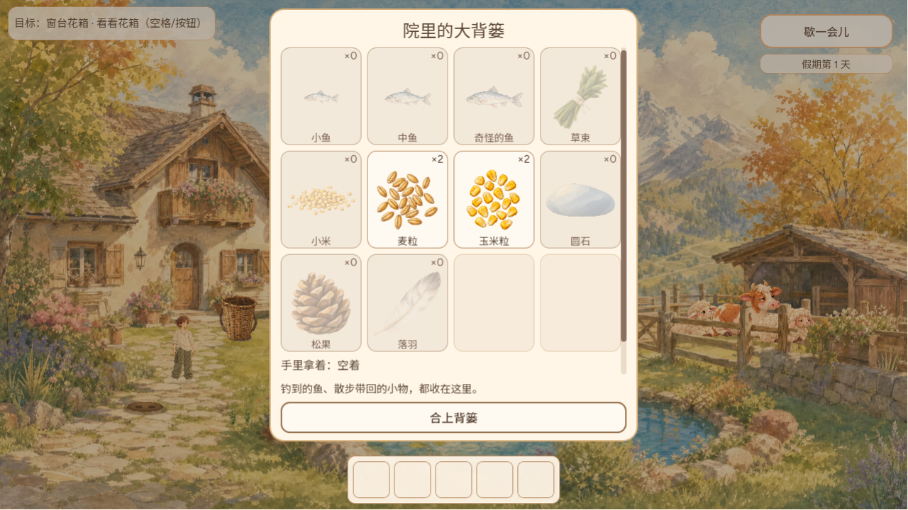
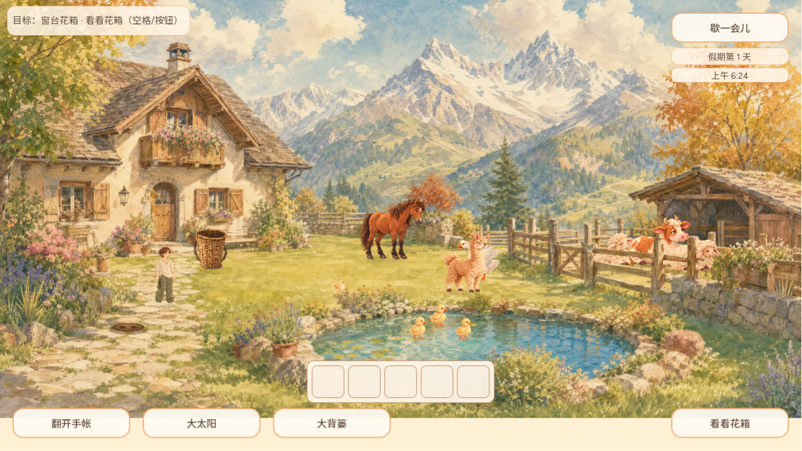

# 院内 Tab 轮转加入快捷栏五格（CURSOR-CLOUD UI 维护）

## 问题

#759 让 Tab 能轮转院内底栏按钮，但手持快捷栏的五格不在轮转里。纯键盘玩家能打开背篓，却不能从快捷栏取物，也不能点空格子去配置。#759 的 README 已把这一点列为已知限制。

## 改动

- `scripts/main.gd` 的轮转顺序按画面从左到右排：翻开手帐 → 天气 → 大背篓 → 快捷栏五格 → 行动 → 歇一会儿。快捷栏隐藏或背篓开着（配置态）时，五格不进轮转；被禁用的格子会跳过。
- 回车/空格按下格子时走格子自己的处理，与点击相同：空格子打开背篓；放了东西的格子取到手里；再按一次手里那格就切换点地投放。
- 改为只认键盘轮转选中的那一个按钮（`_hud_keyboard_target`）。快捷栏格子本来就是 `FOCUS_ALL`，鼠标点格子也会拿到焦点；如果按“当前焦点”判断，之后的空格会按到格子。现在鼠标点过格子后，空格仍是互动。
- 底栏按钮失焦后照旧恢复 `FOCUS_NONE`。格子保留自己的 `FOCUS_ALL`，不改。
- 只改 #759 新增的几个函数，不碰 `_build_hud`、`scripts/ui/hold_hotbar.gd`，也不碰 #720/#738 的方法。

## 回归

`test/hud_keyboard_focus_suite.gd` 扩到 339 项，三个视口检查：

- 轮转包含五格，顺序与画面一致。
- 空格子回车打开背篓。
- 放了东西的格子回车会发出“取到手里”的请求。
- 走路键放下格子焦点。
- 鼠标式地让格子拿到焦点后，空格不会按到格子。

快捷栏配置会跨档保存，所以每个视口开始时先清空五格，并把上一个视口拿在手里的东西放回背篓。

改后全过；只有 #759 底栏轮转的 main 失败 45 项。另外 12 个快捷栏、输入和背篓套件全部通过。

## Web 实玩证据

本地 Web 导出，Chrome 1280×720，全程只用键盘（标题页 Tab、回车进院）。

| 场景 | 截图 |
| --- | --- |
| 改前（#759）：院内按 4 次 Tab，跳过快捷栏，直接到「看看花箱」 |  |
| 改后：按 4 次 Tab 到快捷栏第一格，格子出现深色描边 |  |
| 改后：再按 2 次 Tab 到第三格 |  |
| 改后：空格子上按回车打开大背篓 |  |
| 改后：关掉背篓后按 D 走路，焦点放下 |  |

## 已知限制

- “放了东西的格子回车取物”由原生套件覆盖；Web 上只用键盘把物品放进格子要经过背篓纸片，本轮没有拍。
- 鼠标点过的格子不算键盘选中，之后按 Tab 从「翻开手帐」重新开始轮转。
- 格子的焦点描边是快捷栏原有的深色细边，较淡；本轮不改格子样式。
- 标题页提示仍未写 Tab。
