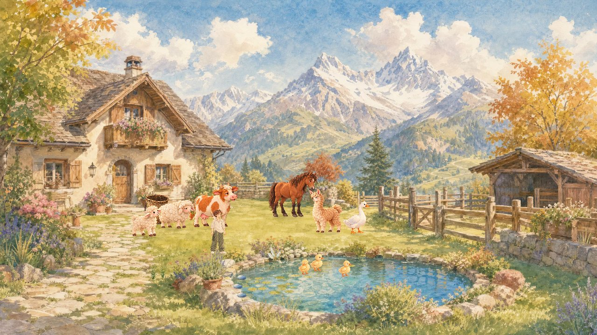

# #700 池边自主施工运行候选

Owner: CODEX-LEAD。基线 main 50ccdbd64ec36218b4519974498918cf0abf9cba。

显式调度的导演挂入真实 YardWorld：沿现有寻路走到合法池边工位，工序按 RestContext.work_speed 计算，调用既有单笔 SaveStore 事务提交 AP/材料/世界结果/经验。确认之前不出现新石头；工作前被玩家点击、键盘移动、菜单/房间占用、日期或外部时段切换打断不扣材料。已受理写入保留操作ID直到确认/拒绝，不把玩家接管当作撤销落盘。

本片保持 Draft：普通场景没有 begin 调用；没有默认食谱、成本和饭点，实时段由调用方 Callable 提供。演示的1 AP/1石/1经验/2秒均为隔离夹具。取材往返、正式施工动作、三餐集成与手机/普通Web体验仍未完成；弯腰使用现有 pickup 临时动作，不冒称新施工动画已经验收。跨日余点不清零、不继承。

验证：原生真实World+Native存档45项；OpenGL同流程47项（含2张截图）；预算74、结果视图50、房屋154、休息43回归；Web导出exit0。首次复用旧测试存档导致budget/rest失败，独立目录重跑通过；首次导入缓存缺失后重新import。日志仅以含完成行且无SCRIPT ERROR为通过依据。完整CI以PR记录为准。

图像是原生隔离夹具画面，未覆盖普通玩家完整成长闭环。声音听验邮件尚未收到用户确认，未加入新的音频。

运行（PowerShell）：设置 APPDATA 和 YOUJIA_TEST_ISOLATED_DATA 为同一个新临时目录，先 Godot --headless --editor --import，再 Godot --headless --script test/pond_growth_director_suite.gd。不同套件使用不同目录。GPU截图可设置 YOUJIA_DIRECTOR_CAPTURE 为存在的输出目录，去掉 --headless。
