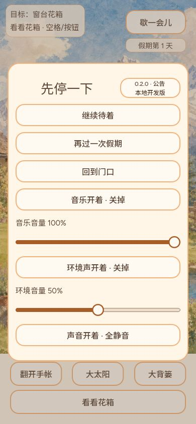
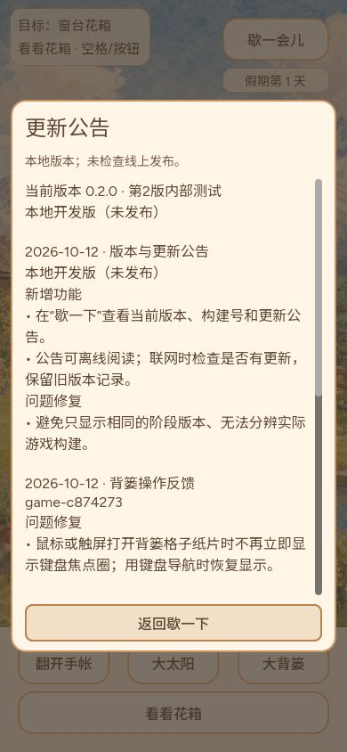
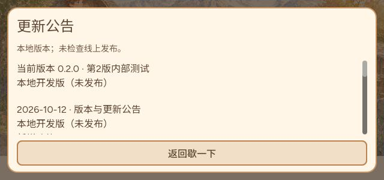

# #771 更新公告候选 — CODEX-LEAD

用户截图为 game-25aa96a；核对时（2026-10-12 21:10后）线上HTML与manifest均为c874273bc16f6b99e43da49de8907008f52d44d9。Publish38251572537及Pages38253876888成功。10月11日日结已记录延迟至12日凌晨发布85c4046。

本切片：歇一下标题旁显示0.2.0与实际构建号，点击可读随PCK发布的历史新增/修复公告。联网仅检查最新manifest身份，不替换本包公告或自动刷新。离线、HTTP失败和格式错误不报最新。当前候选尚未公开发布。

## 验证
- 最终专项66检查：四尺寸1280×720、390×844、280×640、640×300；暂停不泄漏、Tab/四方向焦点、Esc两层返回、历史内容和检查失败。
- pause_panel_fit 1291通过；menu_keyboard_focus207通过。
- GPU实际渲染50检查通过，下面是受控原生运行截图，不冒称普通Web/实体手机体验。后来补焦点邻居专项至66、颜色样式保持。
- 最终Web导出成功。工作流导出前盖章 config/build_identity.json，运行时读取本包身份。手工本地导出以基线c874273盖章，仅验证导出，不冒充线上c874273实际含候选。
- 第一轮暂停布局失败27项，移除额外占行构建标签；第二轮标题垂直布局失败35项，修正标题伸展与按钮边距后1291通过。最初GPU和其他套件共用隔离存档目录失败，改用独立目录后通过；不计首次失败为通过。
- 仍缺：候选普通Web真实网络“最新/有更新/断网”交互、实体触屏；目前仅状态函数和原生输入覆盖。未自动更新或清理玩家存档。

发布后须核对实际PCK、manifest与公告显示身份，再回原单交付。

## 入口缓存修复（用户重新打开 Chrome 仍见旧构建）
- 公共入口 HTTP 实测 `Cache-Control: max-age=600`，关闭浏览器不能保证清除磁盘缓存。该证据不能区分用户当时的浏览器缓存和 CDN 延迟。
- 加载器在任何存档宿主或引擎初始化前，以 no-store 与唯一查询参数获取发布 manifest；发现不同构建后最多自动获取一次带唯一参数的新入口。仍不匹配就停住并提供手动重试。
- 内部重试标记一分钟内有效，匹配后清理地址标记；旧书签重新核对版本，避免永久固定在某次发布。网络失败或4秒超时继续可用旧包，不声称最新，不删除任何存储。
- `release_check_test.cjs` 覆盖当前/旧入口、有限跳转、旧书签、离线、错误清单、超时；`loading_shell_test.cjs` 覆盖检查期间及旧页重试期间不初始化引擎/存档，匹配后恢复正常启动。
- 这是候选修复，已被缓存的旧版 HTML 需先获取一次新版才能拥有检查能力；普通浏览器真实网络场景仍待验收。
