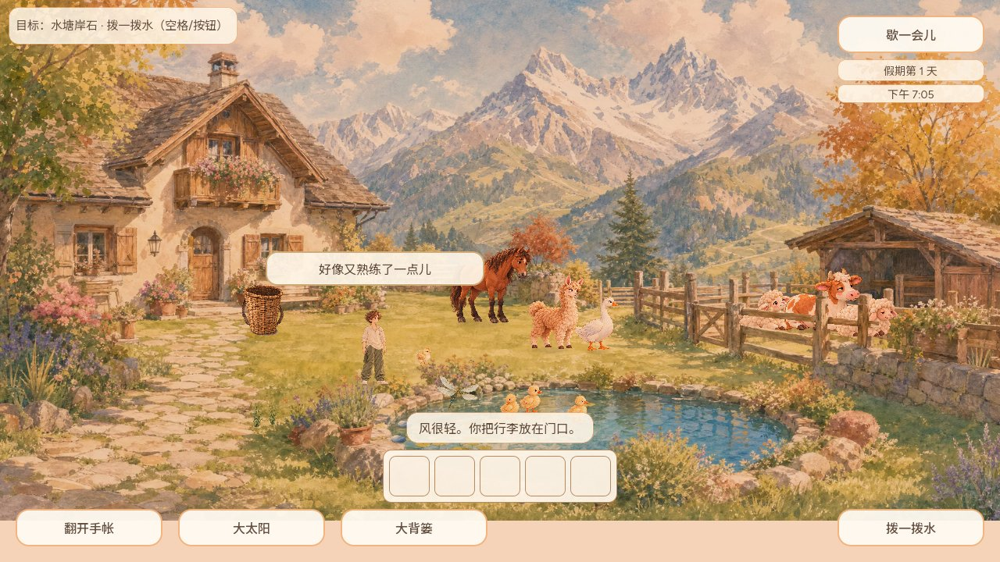

# #700 成长完成气泡

CODEX-LEAD，2026-10-13，接续PR766。普通Main收到真实成长事务确认后，使用已有绘本气泡显示“好像又熟练了一点儿”。不显示AP/经验面板，不改变经验或解锁规则，不加入新音频。

施工确认版本用来去重；进入游戏先读取当前版本。菜单、进屋、其他气泡占用时丢弃本次提示，不排队补播。保存拒绝没有成功提示，重复确认超过气泡冷却后也不会再播。继承既有8秒全局/12秒本行冷却和3.6秒显示。

初版借用保存错误追踪表去重，回归发现该表在保存空闲时清空，导致重复回执重播，before.log保留。已改用施工记录版本。第二次测试把拒绝写入的错误UI带到后面的独立成功案例，fixed-fixture-before.log保留；已隔离案例，并用实际成功的磁盘记录验证重开。原气泡120项通过；GPU271项通过（含Main确认/菜单/拒绝/重复回执/真实成功存档重开及此前三餐施工回归）。截图经正常Main帧计算角色深度和镜头后捕获，未初始化帧不作正式证据。

仅为原生GPU与隔离存档验证，不代替普通Web/手机体验。上一91f3091完整CI38302408198成功，本次完整CI看PR新头。保留Cloud已合入的焦点改动和作者提交。PR仍Draft，施工正式动作及平台验收未完成，未上线；原生Goal历史blocked状态未被伪称恢复。此前本地HTTP预览启动被自动审批拒绝，未换端口或服务器绕过。
