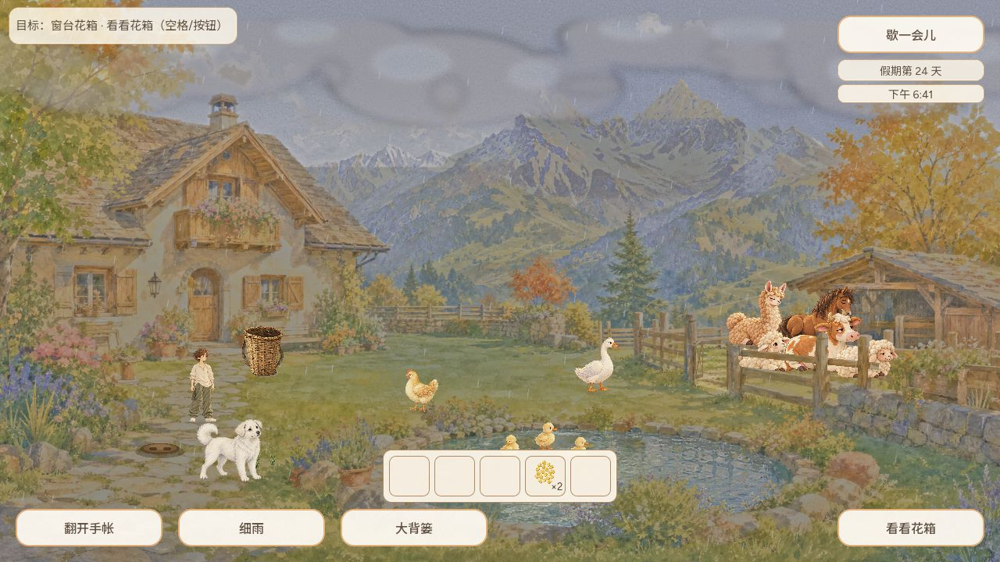
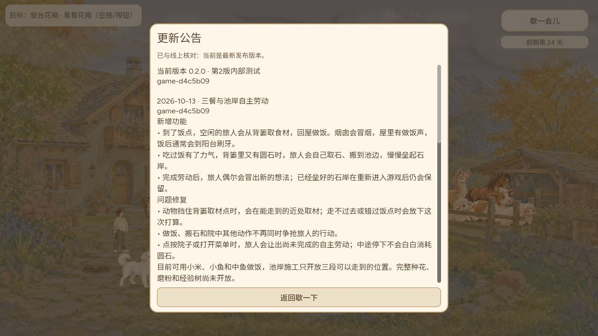
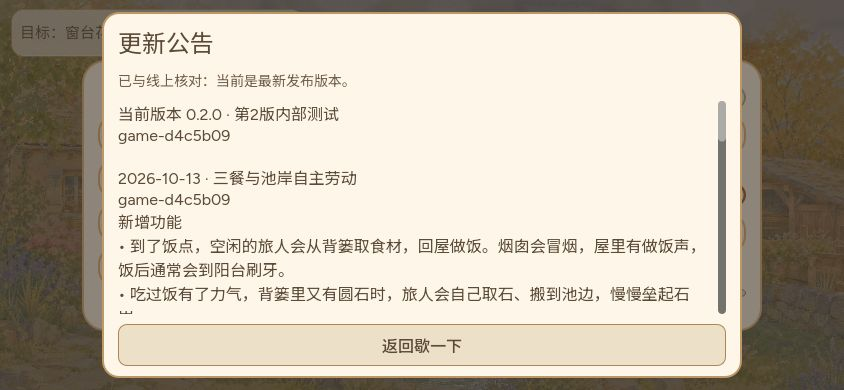

# 三餐与池岸自主劳动公开发布核验（2026-10-13）

Agent-ID: CODEX-LEAD。运行变更由 [PR766](https://github.com/narutojzm1-dot/youjia/pull/766) 交付；本目录只归档已发布包身份及后续公网体验，不修改运行代码或重发同版。最终候选、完整普通Web操作链和音频生命周期证据已由 [PR789](https://github.com/narutojzm1-dot/youjia/pull/789) 归档，见[普通成长体验](../2026-10-13-growth-ordinary-web/README.md)。

## 精确发布身份

| 项目 | 结果 |
|---|---|
| 实际合入/发布源 | `d4c5b092a465186316c5ff35d0a17d2c57b0b379` |
| 最终实玩头 | `48f02b32215629de6393ac6e6bec83786054b4d3`，与合入源同树 |
| Publish Actions | [38356713339](https://github.com/narutojzm1-dot/youjia/actions/runs/38356713339)，completed/success；GitHub updated_at `2026-10-13T06:46:06Z` |
| Pages | [38358583924](https://github.com/narutojzm1-dot/youjia/actions/runs/38358583924)，completed/success；GitHub updated_at `2026-10-13T06:47:24Z` |
| 固定 gh-pages | `6a2beb29364ecacde9f13e3759c87f18be4e16c4` |
| 公共 manifest / HTML | `game-d4c5b09`，完整 sourceCommit 与上述源一致；publishedAt `2026-10-13T06:45:47Z` |
| 实际公共及固定PCK | 两端均 `74,659,076` bytes |
| 两端PCK及HTML声明 SHA-256 | `c41dcb0f65c9fb18d00b10f24ae0770c9a1d6fadf162b0325f225b42177bf601` |

这次从 `06:48:07Z` 开始读取公共 manifest、HTML、固定 Pages manifest，随后实际下载两端 PCK，于 `06:49:10Z` 完成。Pages 成功后的首次取包即一致，无传播期失败或重试。未把旧 `c44cc7e` 或其他已发布版本算成本次成果。

`verification.json` 保留每个请求的URL、HTTP结果、时刻、字节数及SHA-256；`actions.json`保留工作流身份与结果；两份manifest逐项一致。`public-index.html.gz`是原公共入口字节的无损gzip副本，解压内容SHA-256为 `a87f95838bdc4ad0cc920fbd5966ee461c15803f8fbd8a1bb7a445cb4e934f1c`，原长度364139 bytes。PCK大文件保留在本机Temp核验目录，不放入仓库。

## 随包公告与范围

本包公告首条为“三餐与池岸自主劳动”，列出实体背篓取材、回屋做饭/烟囱/刷牙、搬石垒岸及重开保留，以及取材受阻、动作争抢和玩家接管修复。仍保留 c44cc7e/eb8b93d 历史；不是从PR正文临时生成，公告内容随PCK固定。

三餐目前使用小米、小鱼和中鱼；自主施工已开放三处可达岸段，普通实玩完整成长链覆盖首段，不能声称三段均已逐项实玩。完整种花、磨粉与经验树仍未开放，#700保持开放。13/14/15退回音效继续禁播；11/12保留批准源PCM。软件目的端输出不等于人耳或实体硬件听验，实体手机和窄屏全成长链仍未覆盖。

## 普通公网入口复验与成果预览

CODEX-LEAD 从普通公开入口进入新的浏览器标签页，恢复同源第24天存档；「歇一会儿」显示实际构建 `game-d4c5b09`，公告显示“已与线上核对：当前是最新发布版本”，本版新增功能、问题修复及未开放范围均可读。844×390视口下公告可滚动到历史记录，再返回暂停菜单。成功操作链收集到的 console warning/error 为空；这次公网复验覆盖启动、原档恢复与公告操作，不等同于在公网重新走完全部成长或实体手机触摸验收。

首次对长期打开的测试标签页进行普通重载时，加载页停在“引擎已启动，正在绘制画面…”，96秒时仍无新增加载进度；截图和点击的CDP请求均超时，只取得 `36` 的文本快照与空console记录。关闭该代理测试页后，另开普通标签页立即启动并完成上述操作。原因尚未确定，保留为未解决现象；不能据此认定浏览器缓存是根因，也不称已修复。空console不证明该次渲染正常。

| 文件 | 实际覆盖 |
|---|---|
| [36-first-load-stall.txt](36-public-d4c5b09-first-load-stall.txt)、[36-console.json](36-public-d4c5b09-first-load-console.json) | 首次原测试页重载停在绘制阶段；无可用截图，原因未定 |
| [37-existing-day24.png](37-public-d4c5b09-existing-day24.png) | 新普通标签页恢复同源第24天院子与现有库存 |
| [38-pause.png](38-public-d4c5b09-pause.png) | 暂停菜单实际构建号 `game-d4c5b09` |
| [39-latest-announcement.png](39-public-d4c5b09-latest-announcement.png)、[39-console.json](39-public-d4c5b09-console.json) | 与线上核对成功；新增、修复、当前范围可读；成功链console warning/error为空 |
| [40-844x390-announcement.png](40-public-d4c5b09-844x390-announcement.png) | 844×390公告内容与返回入口可见 |
| [41-history-scroll.png](41-public-d4c5b09-history-scroll.png) | 同一横屏视口滚动历史公告 |
| [42-844x390-pause.png](42-public-d4c5b09-844x390-pause.png) | 从公告返回暂停菜单，构建号和操作入口保留 |

2026-10-13 14:57:28（北京时间）已发送一次本片**上线阶段成果预览**，附可直接查看的公开体验截图；这是成果预览，非日版本邮件。发送去重保留在私有项目邮件状态，仓库不保存收件地址、邮件标识或原文。无回信不等于用户验收，不重复发送同版同阶段。

`files-sha256.json` 列出本目录原始证据与文档的字节数和哈希（不包含清单本身）。截图沿用原始PNG，未修改内容；无存档清理或注入。
