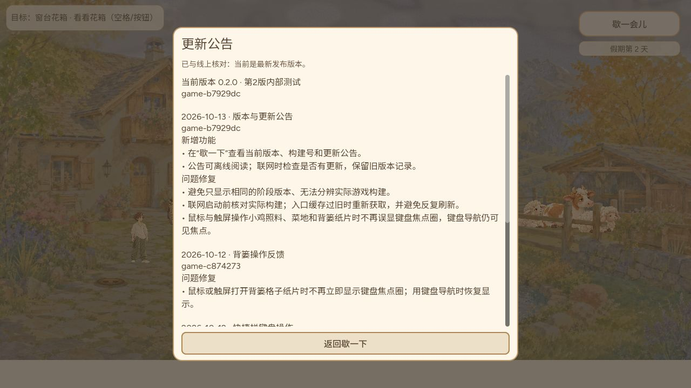
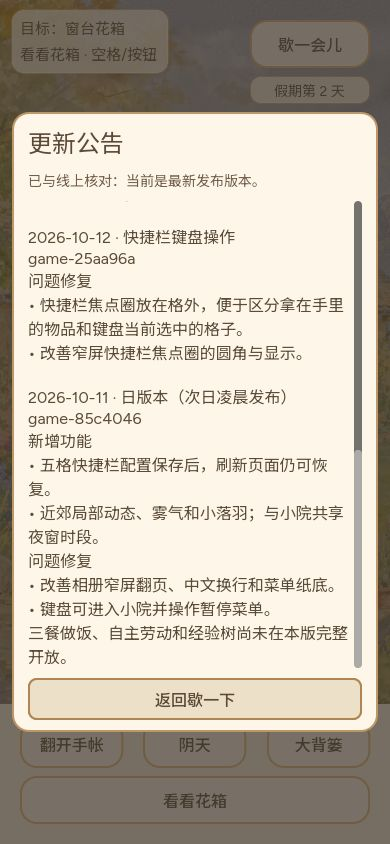

# #771 公告与启动更新检查：普通 Web 候选验证

Owner / 执行：CODEX-LEAD。日期：2026-10-13（北京时间）。PR #773 已合入，合并提交 `eb8b93d2e452c468afadd3d91f71893612c19102`；公开发布核验待完成，本记录不宣称已上线。

## 版本与范围

- 最终运行源码：`b7929dc7b982788ea4126f9f08424770a09050ed`。
- 最终本地 Web PCK：`74464656` bytes；SHA-256 `2d492af6151f79f062592137ca28bb2f432b82c02e0719a2474efe5d38950066`。
- 前一轮操作链源码：`149b5f0df1810ccf0df1c35df6ce452ee8e8758b`。该轮发现启动前旧入口停止页没有标题、重试仍为英语；最终版本把标题、版本、实际入口构建号及中文重试初始化移至版本检查之前。
- 本机 HTTP 候选入口的普通 Web 运行与浏览器操作，不是线上 Pages 验收。桌面鼠标、键盘与调整浏览器视口已测；没有实体手机或真实触摸输入证据，窄屏截图不等于触屏验收。
- 旧入口场景使用本地可控 HTML 身份夹具：替换入口中的构建身份，以验证自动重取与停止分支。没有把夹具当作真实旧生产 PCK，也未据此证明用户原缓存问题的唯一根因。

## 已执行的操作链

| 源码 | 操作 | 结果与证据 |
| --- | --- | --- |
| `149b5f0` | 桌面鼠标进入歇一下并打开公告 | 当前版本与实际构建号可读；有新增、修复和历史条目。`01-current-notice-1280.jpg`。 |
| `149b5f0` | 键盘 Esc 退出公告，再以 Return 重开 | 公告关闭后仍在暂停菜单；可继续用键盘打开。 |
| `149b5f0` | 844×390 窄横屏打开公告后返回 | 公告与暂停菜单均在视口内，返回保持暂停。`02-notices-844x390.jpg`、`03-pause-844x390.jpg`。 |
| `149b5f0` | 390×844 竖屏滚动公告历史 | 能读到历史条目。`04-history-390x844.jpg`。 |
| `149b5f0` | 返回错误 schema 的发布清单 | 公告显示无法检查，不把错误清单判为最新。`05-invalid-manifest.jpg`。 |
| `149b5f0` | 游玩期间公告取得不同构建清单 | 只提示线上版本不同，未强制刷新，当前公告仍属于正在运行的包。`06-different-version-no-refresh.jpg`。 |
| `149b5f0` | 可控旧入口自动重取后进入院子 | 第2天存档恢复。`08-restored-day2-after-update.jpg` 属于该父版本，不作为最终版本更新后进院的证据。 |
| `b7929dc` | 清单返回 404 后启动，再打开公告 | 游戏仍可启动并恢复第2天；公告显示无法检查，随包历史可读。`09-final-404-notice-390.jpg` 背景可见第2天。 |
| `b7929dc` | 可控旧入口身份遇到当前清单 | 自动重取当前入口，匹配后清除 `release` / `_fresh` 查询标记；此后转测旧入口停止分支，未立即进院，不把父版本的08截图归为本次恢复。 |
| `b7929dc` | 重取后的入口身份仍与目标不符 | 停止启动并提供中文重试；保留游戏标题和实际旧入口构建号，没有把目标新构建号冒充已加载版本。`10-final-stale-stop.jpg`。 |
| `b7929dc` | 最终桌面版本再次打开公告 | 公告显示正确，浏览器控制台 error / warn 均为空。`11-final-current-desktop.jpg`。 |

`07-bounded-stale-stop-before-localization-fix.jpg` 保留修复前的真实缺陷：旧入口停止页缺标题、重试为英语。它不是最终通过截图；最终修复见 `10-final-stale-stop.jpg`。

## 自动验证与边界

- 原生公告专项 `87` 检查通过；包含 release/v1 schema、40位小写十六进制 SHA、entry 匹配，以及缺失/错误 schema、非 hex、大写、过短/过长身份的拒绝。
- `node test/loading_shell_test.cjs` 与 `node test/release_check_test.cjs` 均通过。加载器新增检查等待中及旧入口停止时的标题、阶段版本、实际构建号和中文重试回归；原有有限自动重取、离线/错误清单/超时、引擎与存档宿主启动顺序保持。
- 此处普通 Web 实测失败场景包括 404 和错误 schema；8秒公告超时、4秒启动检查超时等专项覆盖不能改写成已在浏览器逐项实测。
- 最终运行源码 `b7929dc7b982788ea4126f9f08424770a09050ed` 的 [CI 38340525641](https://github.com/narutojzm1-dot/youjia/actions/runs/38340525641) 已成功，PR #773 已合入 `eb8b93d2e452c468afadd3d91f71893612c19102`。公开 Pages、manifest / PCK 哈希核验仍待完成，未宣称上线。
- 实体手机、真实触摸、真实旧生产包的浏览器缓存与 CDN 更新传播仍不在本轮证据范围。

## 证据

原生布局及早期修订历史见 [10月12日候选记录](../2026-10-12-release-notices/README.md)。本轮普通 Web 证据补足其中对应的历史等待；未覆盖平台不随之视为通过。
