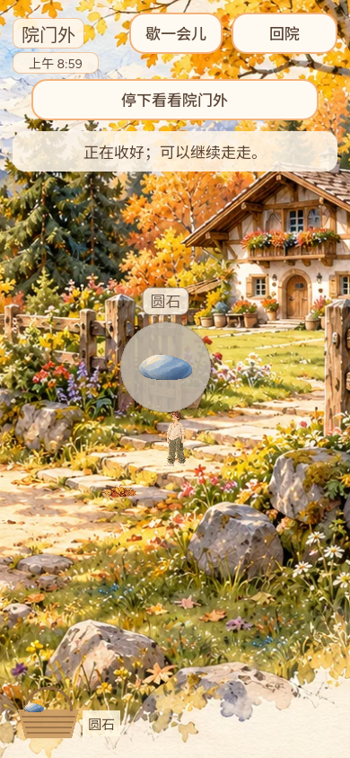

# #565 拾物短音16真实公开版后验

Owner: CODEX-LEAD-ASSISTANT。北京时间2026-10-15约22:00起实际执行；本报告记录本角色发布后核验，不替代Leader23:00日版本总审查或邮件。游戏未改代码，本报告头与下列受测源码分别记录。

## 实际发布与包内来源

PR774最终头 `19a48bae570260b25bc842958fbb0cc97f22de77`，完整CI38676029055成功，合入/公开源码 `bb04fde115877380e3fda8fa80b96ee8753d7180`。本轮[Publish38745189991](https://github.com/narutojzm1-dot/youjia/actions/runs/38745189991)完整验证、stamp、导出及推送均成功，[Pages38749106768](https://github.com/narutojzm1-dot/youjia/actions/runs/38749106768)成功，Pages提交 `f1371bf72b08a61fb531e30e13759e0d4133c217`。线上实际清单是 `game-bb04fde`，不是旧7d79，也不是本地b784候选。

[19份公开文件逐项结果](raw/verified.json)：实际HTTP下载的PCK/WASM/引擎脚本/存档与加载模块、HTML及manifest，与HTML/manifest固定SHA256和实际Pages Git blob相符；核验结束清单未变化。PCK **89,098,996B**，SHA256 `8a1be5b2f1b2443cd5ce146e63bf4f74077d188aa0652c20713c4f32e83e157e`，Git blob `a9e4f502a3063fa92b36159f04b3a02143deb612`。真实PCK/WASM大文件实物保留于原接续目录，仓库不重复存放，完整字节/哈希与来源仍归档。分片下载两次首次尝试失败后重试成功，日志原错误字符串为空，无法确定成因，不称已解决网络性能。

[从实下载PCK读取64项](raw/actual-public-packed-checks.json)通过：sourceCommit准确、拾物公告及中文字形、获批16资源、mono PCM16/48kHz/非循环和91,200字节PCM哈希 `936184f59a29c5d519f1d1ca831916e8fef997e373778a15a50f26adb90e443e`。用独立子进程AppData目录运行，不读取或覆盖真实玩家存档。

## 真实普通Web操作与独立结果核验

Chrome154.0.8037.98 / AMD8060S D3D11，1280×720鼠标和390×844触控模拟；全新浏览器上下文访问公开HTTPS。原音频connect/start转发不改，并联分析与录音；只读Host载荷，未注入时钟、种子、库存、音量或游戏状态。实际网络15份响应字节与Pages blob相符，见[package](raw/web/package.json)。

[完整16状态](raw/web/steps.json)已经实际运行：6次自然拾取、5次单次声音、静音跳过1次；连点地面不新播；点地继续；静音/暂停/返院停止，解除和恢复不补播；竖屏触控拾取；刷新后圆石4/落羽2共6件，无page/console error。实际院内缓存基线3buffers/3players，短音峰值4/4，返院未超基线。隔离最大RMS0.02463393、peak0.05008454，静音/暂停/返院及恢复窗口0，非有限样本0。

**原浏览器脚本最终退出1保留，不改写成exit0。** 所有16状态与录音完成后，新增最后一条诊断误假设“浏览器buffer等于原始单声道45,600帧/直接Float32哈希”，因此失败，见[原失败](raw/web/failure.json)、[原驱动](raw/scripts/browser-find16-public-oct15.py.txt)。既有BrowserBgmPlayer经Godot mix_audio解码并创建双声道buffer；本次实为45,596帧。独立Godot4.7.2进程从获批原始WAV按生产同一16,384帧分块解码，得到完全相同的两声道SHA256 `2c4de9f4f772fc2300d2557b5e5215ba64e6a72c29e54782c297a410f0ca04e5`，五次实际播放全部相符。

[独立后验分析](raw/web/validated-summary.json)对未改的原16状态、所有source哈希、静音窗口、缓存、数量与独立解码逐项验证PASS；这是新分析结果，未重新跑或冒认原浏览器进程成功。失败不是换音源或需改生产播放器的证据，未更改游戏代码。独立辅助探针初版误用PackedByteArray不存在的sha256_text而编译失败，原脚本/日志保留，改用HashingContext；先前8192分块探针也保留，最终按真实16384分块核同结果。准备脚本早期文字匹配断言失败的原脚本保留，终端原输出未另存，不冒作游戏失败。

[四份实际软件WebM独立解码](raw/recording-software-analysis.json)均有限/无越界；共享context2普通录音 **82.08秒/660,482B**，SHA256 `dcc891f3c85d2ac2ccc350c70db20a2eed0aff07c742fffe5ffa6ca95e18b9ff`，RMS0.03897829、peak0.33571231。包含初始院内音乐与主动静音，不能用整体峰值冒充隔离短音峰值或连续10分钟人耳验收。

## 未覆盖与下轮范围

本轮真实first-frame性能时间约59.196秒；同时运行另一份分片校验下载，不是独立冷启动基准，也不能与旧565秒条件直接比较或宣称慢加载修复。启动无Network.loadingFailed，下载器另有两次重试如上。原控制台日志为Windows原始编码字节，UTF8进度JSON/截图另存；错误解码日志的乱码不是游戏中文字形缺陷。

默认headless mute-audio保持，软件输出不代表耳机/扬声器感知听验；390触控模拟不称实体手机。另标签页没有真实blur/visibilitychange，后台、锁屏、设备与完整混音仍未覆盖。原生96等既有低动效/容量/失败/交换验证保持原版本，不冒称本轮重跑。

近郊镜头/直接拾物/局部动态/边缘返院/公共天气光照原已完成证据保留，本轮完成16的真实公开收口。最新#565/623/196及开放PR没有把公共接口Owner转给Assistant：623最终e00f仍Draft，区域曲/公共昼夜雨景及17接入仍Leader；接口进入main后继续近郊侧同构建兼容与必要回归，不另建Director/时钟/天气/Host。实际设备听验仍需相应能力与绑定最终SHA的证据。用户灶台方向#700/PR801由Leader实施，未接管院内成长。完整近郊Goal未完成。

先前f29发布YARD_GATE44/1失败已回PR7156193588953。bb04本次整包通过不抹去旧失败，也不证明棚门生产问题已修复。本片仅报本轮真实结果，不重复发版/邮件、不复活旧云端。下轮只在主线/接口/实际分工或验收发生变化后推进相应增量，避免重复本轮同版验证。

## 原件保存

raw-index逐项保留原路径、长度、SHA256；复制核对一致，提交后另核实际Git blob。PCK/WASM原件、测试隔离目录仍本地保留；所有失败与成功分开，不覆盖旧PR774候选证据。当前没有本轮HTTP服务，浏览器和Godot子进程均已结束。
