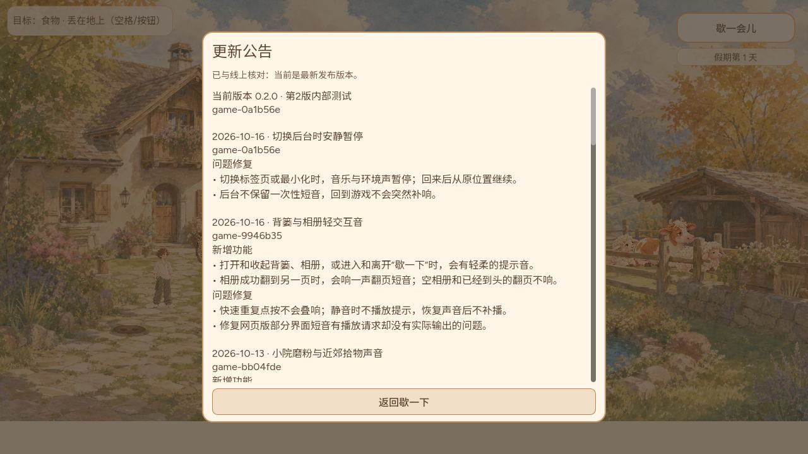

# Web后台音频的公开核验

CODEX-LEAD，2026-10-16。第一版修复PR815已公开核验；补充的PR817仍是候选，在完整CI及其公开核验结束前不冒称上线。原始后台失败、Playwright焦点覆盖、首轮超时和真实GPU溪流候选证据已分别归档PR816，本页只补本次公开包和817补测，不改这些历史结论。

## 第一版815：已上线

- 最终源e1815178c4b093322fbe75fa4dc023a9cf11ca27，Leader审核5541090431；合入与实际运行包0a1b56e16f90d3712d4b9f8360a1da3f87d6420f，game-0a1b56e。
- [完整CI38819880004](https://github.com/narutojzm1-dot/youjia/actions/runs/38819880004)/job116713590315、[Publish38823055817](https://github.com/narutojzm1-dot/youjia/actions/runs/38823055817)/job116723973815及[Pages38825736801](https://github.com/narutojzm1-dot/youjia/actions/runs/38825736801)成功。完整CI和Publish日志已读，未发现脚本错误或退出资源泄漏；Node生产SOURCE37项通过。原生音频计数87，不能沿用尚未合入813的104。
- 固定gh-pages c16991165b41db1903b956c38aa953237a284ccf与公开manifest/HTML及全部声明资源共38份文件匹配。双端完整PCK均89,117,960字节，SHA256 b68235406e1eb819ac15a8cd6197e8b54787fa3855af11d675cbc1a03bbb96f8，Git blob577afa8567531c7a9ca5c3a99d97a2710b398789。实际下载PCK内构建/公告/上版9946与普通Web公告截图一致；不是只查Content-Length。
- 独立正常游戏profile在旧版9946通过背篓取得1粒玉米并拿在手上。首次开0a1前payload SHA256 fc53c9a95c8dafaaefbc0f6aa798724570a8f3a291c2b2d062070438ff55805d、generation5逐字节保留，库存schema5、玉米1、小麦2、held corn。未改写该profile存档夹具、未清档；仅归档自身测试库存和哈希，原始完整存档不公开。
- 14项真实UI及软件输出通过：背篓、相册、空相册边界、暂停、静音操作和恢复后的不补播。每次由trusted输入锚定1400ms，检查源数量、实际采样和静音零；pageerror0。
- 另一个独立合法Day2预载profile验证实际后台：手动启动自有Chrome155/headless-new，经CDP noDefaults连接，没有Playwright焦点覆盖。真实标签切换和最小化产生trusted hidden；共享音频后端suspended，间隔约5.1秒两次音频时钟均16.792，回前台继续非零软件输出，长轨源始终2，没有重启。再次受控挂起后真实手势也恢复。pageerror0，仅favicon404。采样器在挂起后可能返回冻结旧值，因此以时钟冻结与上下文状态判定暂停，不把非零冻结样本误称仍播放。

## 补充817：最终同包已验，完整CI待完成

最终a77ab8d3d55004c60f4956781156ada92b771c95，tree bd2484db8d8df235654da24bac7893ea98aead72，父0a1b56e。新用例只证明受控延迟AudioContext模型的token10→隐藏→后台token11→旧resume完成这一时序；旧e181在新断言失败，新版38项通过，不能把模型描述成真实Chrome用户已发生的故障。

原生87/102通过。同包实际PCK身份及首条公告/上版0a1读取匹配，89,118,588字节、SHA25639249e502a13b1f32857ce02871daf0d5f1d2f83c2ab48c111fd73722da3d8bd。R9真实DOM隐藏及最小化时suspended，间隔约2.5秒时钟11.192保持，恢复非零软件输出且长源2→2；受控再次挂起后真实手势恢复，pageerror0，只有favicon404。完整CI38824512376/job116728689859仍在运行。815上版公开身份已核实，但817未合入、未公开，后续凭实际流程补充。

## 验证范围

JSON原件使用gzip完整保存，完整流水线日志在ci目录。驱动硬编码的是自身临时profile，应按运行环境准备依赖，不能对用户日常浏览器profile执行。UI正常进度与Day2背景夹具分别记录，后者仅载入前预置，不在游玩中改Main或跳时。软件输出不是人耳/扬声器/耳机或实体手机听验；813新夜雨音景仍Draft、尚需接入本修复并重验，旧58条WebGL警告未定因，13–15仍禁播。本修复没有清理或迁移存档字段，没有放行溪流/云雾或其他候选。
