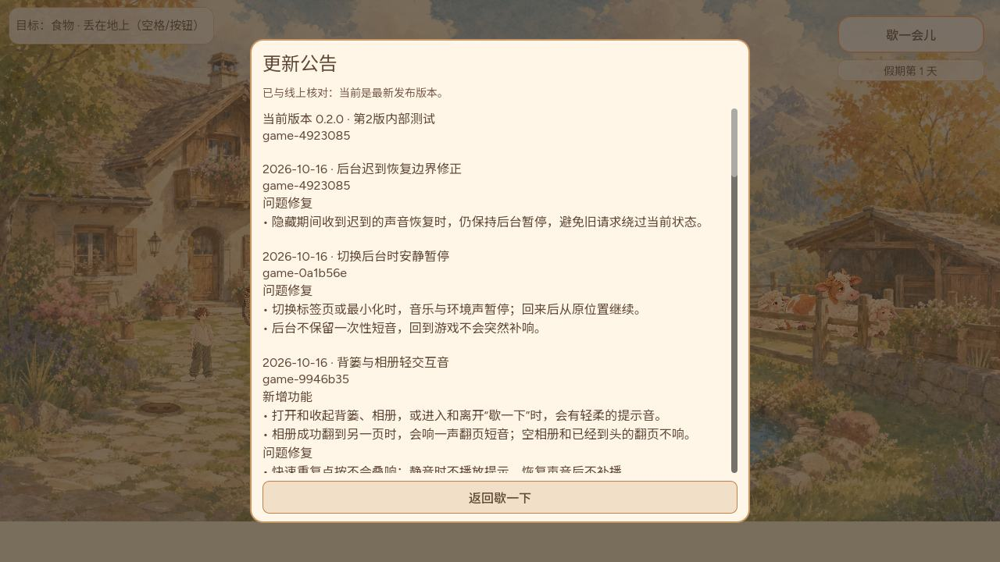

# Web后台音频的公开核验

CODEX-LEAD，2026-10-16。815与817先后完成公开核验，本次最终核验运行包为game-4923085；它是当时实际身份，不永久固定为最新。813已接共享返修并补整包验证，仍未合入/未上线。原始旧版后台失败、Playwright焦点覆盖与首轮超时在已合PR816；这里保存后续完整原件，不把候选试验当发布。

## 第一版815：已上线

- 最终源e1815178c4b093322fbe75fa4dc023a9cf11ca27，Leader审核5541090431；合入与实际运行包0a1b56e16f90d3712d4b9f8360a1da3f87d6420f，game-0a1b56e。
- [完整CI38819880004](https://github.com/narutojzm1-dot/youjia/actions/runs/38819880004)/job116713590315、[Publish38823055817](https://github.com/narutojzm1-dot/youjia/actions/runs/38823055817)/job116723973815及[Pages38825736801](https://github.com/narutojzm1-dot/youjia/actions/runs/38825736801)成功。完整CI和Publish日志已读，未发现脚本错误或退出资源泄漏；Node生产SOURCE37项通过。原生音频计数87，不能沿用尚未合入813的104。
- 固定gh-pages c16991165b41db1903b956c38aa953237a284ccf与公开manifest/HTML及全部声明资源共38份文件匹配。双端完整PCK均89,117,960字节，SHA256 b68235406e1eb819ac15a8cd6197e8b54787fa3855af11d675cbc1a03bbb96f8，Git blob577afa8567531c7a9ca5c3a99d97a2710b398789。实际下载PCK内构建/公告/上版9946与普通Web公告截图一致；不是只查Content-Length。
- 独立正常游戏profile在旧版9946通过背篓取得1粒玉米并拿在手上。首次开0a1前payload SHA256 fc53c9a95c8dafaaefbc0f6aa798724570a8f3a291c2b2d062070438ff55805d、generation5逐字节保留，库存schema5、玉米1、小麦2、held corn。未改写该profile存档夹具、未清档；仅归档自身测试库存和哈希，原始完整存档不公开。
- 14项真实UI及软件输出通过：背篓、相册、空相册边界、暂停、静音操作和恢复后的不补播。每次由trusted输入锚定1400ms，检查源数量、实际采样和静音零；pageerror0。
- 另一个独立合法Day2预载profile验证实际后台：手动启动自有Chrome155/headless-new，经CDP noDefaults连接，没有Playwright焦点覆盖。真实标签切换和最小化产生trusted hidden；共享音频后端suspended，间隔约5.1秒两次音频时钟均16.792，回前台继续非零软件输出，长轨源始终2，没有重启。再次受控挂起后真实手势也恢复。pageerror0，仅favicon404。采样器在挂起后可能返回冻结旧值，因此以时钟冻结与上下文状态判定暂停，不把非零冻结样本误称仍播放。

## 补充817：已上线

最终源a77ab8d3d55004c60f4956781156ada92b771c95/treebd2484db8d8df235654da24bac7893ea98aead72，Leader审核5541390387；合入与实际运行包49230855694b58ed95e10d56abd214dece0c64ed，game-4923085。生产SOURCE38项通过、原e181在新增受控异步模型负例失败，原生87/102和R9同包实测通过。该模型不冒充真实Chrome用户发生过该特定时序。

[CI38824512376](https://github.com/narutojzm1-dot/youjia/actions/runs/38824512376)/job116728689859、[Publish38827391416](https://github.com/narutojzm1-dot/youjia/actions/runs/38827391416)/job116737931186、[Pages38829620082](https://github.com/narutojzm1-dot/youjia/actions/runs/38829620082)成功。完整CI448580字符与Publish552500字符均已读，无脚本错误或退出资源泄漏，原件在ci目录（gzip）。第一轮独立上传CI原文响应未知，后用本地字节完整归档，未将未知上传当成功。

固定gh-pages379884e7cc5a0556bded896bb4e8f58eed795bda与公开完整38文件一致。双端完整PCK均89,118,232字节，SHA256406bf028b1c739a5903b95c2aa4b7d465807cf6cd2c18c84dfeeb37f9db65b8d、Git blob9423fae17b04f18320ac2245d879590d3b28b5a1；实际PCK内身份/首条公告/上版0a1及正常Web公告一致。Linux公开包与Windows本地a77验证包各自记录，不把本地SHA256移称公开包。

同一正常profile从0a1首次开492，payload fc53c9a95c8dafaaefbc0f6aa798724570a8f3a291c2b2d062070438ff55805d/generation5精确保留；14项UI及采样检查通过，pageerror0。真实后台独立profile中，trusted隐藏/最小化时suspended，间隔约9.6秒音频时钟均10.4106666667；返回非零软件输出，长源2→2，受控再次挂起也经真实手势恢复。仅favicon404。

失败原件保留：首次完整文件读取有一次网络超时，重试只复用哈希已匹配的完整文件，部分下载不复用；后台驱动尝试1在manifest请求30秒超时，尚未初始化测试存档。尝试2读到了自有Chrome旧DevToolsActivePort，连接被拒，未进入游戏。尝试3改每轮独立新profile、保留旧profile并将准备请求限时90秒后完成真实流程，未清用户存档、未改变生产更新策略。不能把两种测试准备失败说成游戏挂死原因。

## 813接续：软件链完成，候选总门禁未通过

原PR813更新为4f8dc8de59aa9c9d150cfefc900d2c61df867ada/tree58955248c0e668ec2f6fa8fb81fe44ef67af766c，有序父2ca748c8e11c98340a4709cf1059d8fd2c2330d8与49230855694b58ed95e10d56abd214dece0c64ed完整保留。共享backend/Node38与已发布492逐blob相同；五份源音、声景和Main声音事实不变，不改存档字段。现行decisions/requirements保持main原blob，旧分支历史台账保留在2ca祖先及原证据，不回灌过期等待。仅公告冲突按候选当前→492→0a1→9946整理，492实际公开后该历史门禁才解除。

原生104/129/61/102、Node38、导出和[完整CI38828370718](https://github.com/narutojzm1-dot/youjia/actions/runs/38828370718)/job116741085163通过，完整453300字符日志已读，无脚本错误/退出泄漏。实际同包90,229,152字节、SHA256836a8345cbbeaaee1db6b15ed7205fa7ee540e15c47a3dfd99f2813fbef31711，包内身份/公告及上版492已读取匹配。

R11独立Chrome/noDefaults真实隐藏与最小化共享后端suspended，间隔6.46秒时钟5.1413333333保持，恢复非零软件输出、长源4→4。R10（原默认焦点行为）620.548秒与R12（自有Chrome/noDefaults）621.033秒分别完成正常出院/返院、自然夜雨、确认入屋睡眠、静音零、长轨loop及软件非零输出；均pageerror0，缓存峰值9/192,115,152字节。仅载入前预置合法Day2/sleep初档，游玩中没有调用Main或跳时；R12实际hidden为真。两轮分别关页重开到Day3，corn2/wheat2/schema5与合法rest cause sleep保留，原件及驱动齐备。

**仍不放行813：R10与R12都出现58条WebGL警告。** 后者已是真实隐藏模式，因此不能用“只是Playwright默认焦点覆盖”解释掉该警告。旧短对照R3/R4及新R11未重现，不足以定位根因；也不能据此断言用户停绘制的单一原因。下一步Owner CODEX-LEAD做相同路线/时长的当前公开492与候选、无音频观察器对照并定位首次警告/画面。耳机/扬声器实际混音、实体手机也未覆盖。只有此候选受这些门禁约束，既有源音批准不重等；13–15仍禁播、17未接。

## 验证范围与交接

驱动中的临时profile都属于独立测试，不能改为用户日常profile。UI正常旧进度与背景合法预载夹具分开；软件输出不是人耳或实体设备听验。第一版与补充版源码、候选源码、公开包、普通游玩和受控模型分别记版本，不混成一次验收。

溪流804新头bab9c32d4061ab653a4f8aca70eadf3e63c062ae已接收并经Leader阶段静态审核5541706512：相对已归档2e03211只增契约/成本脚本及shader注释，phase弧度纠正闭环；旧GPU不重署新SHA。仍是未接入候选，原Owner可继续隔离裁切/材质demo；生产近郊仍ASSISTANT，不能覆盖其宿主。现行减少动态撤掉材质，不自动改为候选0.20静帧；生产天气/照片/Web/成本仍须验证。不要求用户重复特定词，也不把阶段反馈当用户最终美术验收。同视觉阶段预览已异步发送一次，不重寄。

本次没有清理/转换存档、没有放行新溪流/云雾，也没有把16日早上的返修当23:00日版本节点。13日/15日邮件去重保持，16日23:00仍按实际节点执行。

## 大文件无损存储

部分较大Git blob写入未返回结果，未据此宣称成功。对尚未确认的大截图/采样原件使用128KiB二进制块存放于large/，large-artifacts.json列出原始路径、长度、SHA256、Git blob和分块哈希。运行`python restore-large.py OUTPUT_DIRECTORY`可逐字节还原，已在归档准备时验证拼回原文件，未重绘、裁剪或降低图片质量。公开公告等较小预览仍直接可看；分块不是运行游戏的资源。
