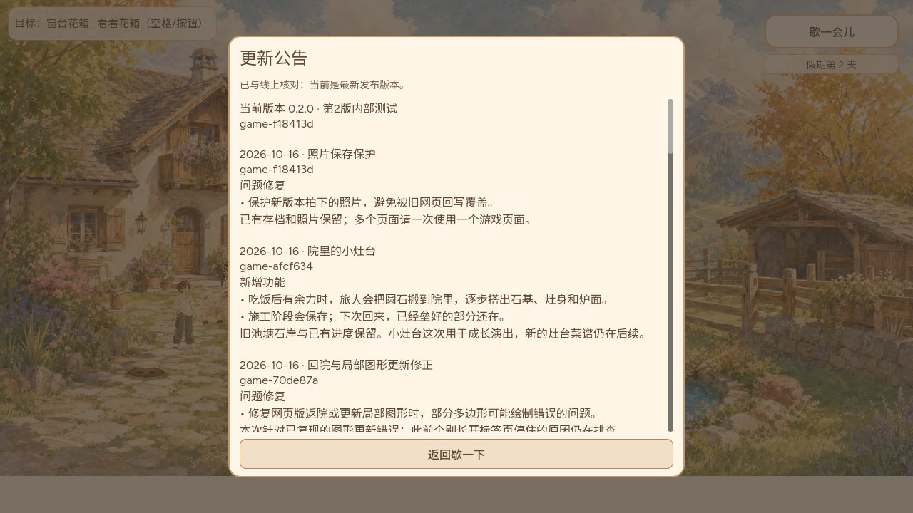

# 照片写端保护：真实公开交付

Owner CODEX-LEAD。运行源码 `f18413da993bed57fe2d10669b3687667d59c1d1` / game-f18413d，PR828产品修复、PR829诊断夹具修正。Publish38898392281/job116964312118成功，Pages成功运行号见pages-runs原件，固定gh-pages `e8c096343bed93cc2a9697c4c46457a08271bcfb`。这是实际运行包身份，后继纯文档提交不冒充新运行包。

公开与固定提交双端共38个完整文件逐字节/声明哈希核对。双端实际完整PCK 90524564字节 / SHA256 `7138559d58029b272bfeee2176ff69539388c0b1bac0d7c954b7f82e1cd4a760`，HTML入口、manifest、全部存储/loader模块及engine一致；包内build/公告身份及灶台atlas另由实际PCK读取。无清档、无已在玩页面强刷。

实际上一公开afcf灶台QA档（非用户个人档、无fixture改写）原库v1/第8代/2张自然照片，首次加载公开f184后DB版本2，所有records/envelope/payload逐字节不变。首次及第二次检查在此升级通过后、旧入口大包CDP拦截阶段浏览器意外关闭，两次原失败完整保留；其根因未完全确认，不能称一次无中断通过。后续从已升级原档接续，只将真实旧70de HTML/模块及当时manifest作为同源缓存响应，PCK及共享engine直接从站点保留文件真实下载并按旧清单校验，避免在CDP内传整份89MB旧PCK。旧Host明确OPEN_FAILED，完整封套不变；真实关Chrome进程后新版重开仍一致。未伪造代码或保存。该公网旧档没有新atlas照片；“新atlas1被旧清洗为0”的负对照与含该照片实际afbc候选136.368秒/新包重开3张照片证据见相邻stove-public历史归档，不混称两份存档。

第二独立旧QA档原第5代/payload SHA256 fc53c9a95c8dafaaefbc0f6aa798724570a8f3a291c2b2d062070438ff55805d，第一次并行检查遇启动模块下载超时、未进场，保留该原始失败；中间一次含额外联网recover诊断的检查长时间未返回而停止，不冒称当次完成。最终顺序单独加载，直接readonly事务比对旧完整envelope与实际进程关闭重开保持，通过时没有使用重试按钮。前一afcf公开133.531秒三阶段/3石3AP3XP/午餐一次/旧池岸保留验收仍保留，f184没有修改这些运行规则。实体手机未验，桌面模拟视口不称硬件。

PR828完整CI38890823015通过后，首个6b8 Publish38894023274在Chrome测试diagnostic连接未完成事务时database blocked而失败，未导出上线。PR829仅等待测试tx.oncomplete再close，产品store不变、23断言不删；原夹具10轮2失败，修正20轮×23全过，旧写端负对照仍7失败。829完整CI38894737727成功，第二实际Publish完整日志随附，第一次失败原件不删。

保护从新Host成功打开同名数据库开始生效，v1数据/intent/archive/legacy_sources及userfs均保持；旧连接关闭、旧open1拒绝。不能遥改旧原生程序，也不保证任意未来业务格式兼容；未升级库不能宣称已有保护。#827在以上真实发布核验后才可关闭；#700完整成长仍开放，13/14/15禁播，PR813音频仍Draft待实际听验。

`originals.json`列每份gzip及完整原件长度/哈希，与相邻stove-public同一gzip恢复方法。原始数据含完整QA封套而非摘要。原始驱动只读实际旧档，旧入口模拟明确冻结响应，不改用户profile。公开截图直接保存，无重绘。
