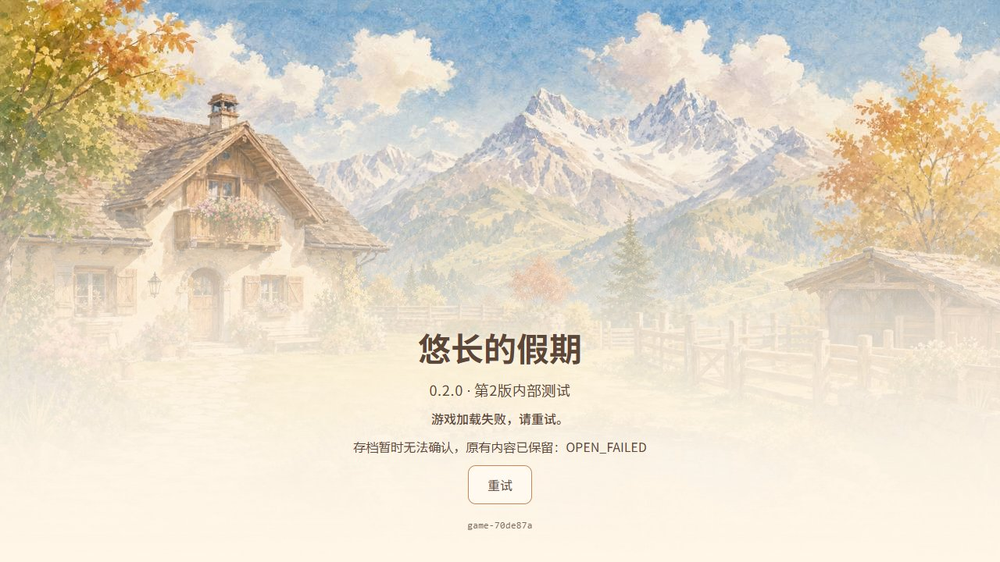

# 灶台公开交付与旧照片写端保护

Owner：CODEX-LEAD。本页区分两个真实阶段，后续公开身份以实时 manifest 为准。

## 已公开：院内三阶段灶台

源 `afcf634bcd90fe1e89f644e133d1bfbd53fb75fb`，PR823/825。首次源 a6774cab 的 Publish38875759141 在追加复现旧AP可重复支用后已取消，未发布；不重跑该旧源。修复后的 Publish38882755756、Pages38885817776 成功，固定 gh-pages `e92202366ea1f48f3602fa544f842ee2642bb9b1` 与公网38份完整文件核对通过。双端完整 PCK 90,524,228字节 / SHA256 `97960ce4b30b8cbb2667fe3041779a3da9b32e0251a3615af639733b2455a758`，固定修补 WASM `fdab8cf15509d9042cd7f6f9f9eafb5201c85a59ed161d91346046b2a9268fe4`。普通公网133.531秒走完三阶段、恰好3石/3AP/3XP、午餐一次、原池岸保留及关页重开通过；独立旧QA档升级前后精确payload SHA `fc53c9a95c8dafaaefbc0f6aa798724570a8f3a291c2b2d062070438ff55805d`、第5代不变。390×844 / 844×390是桌面模拟，非实体手机。


## 追加缺口：#827 / PR828

灶台新照片交给真实旧70de87a PCK后从1条清洗为0条，旧Host可接受覆盖。AP修复及上述实玩不证明此路径安全。PR828源 `afbc80781c7dabc3c82df007cb8c8389cbd60bff` 提高同名Host库写端版本至2；保存格式不变，不清档、不强刷。真实Chrome协议23项通过；旧版本7项失败、仅改版本号的突变体2项失败，完整原件在 `test/photo_writer_epoch/`。

该实际导出包从v1含新atlas照片升级，普通Web136.368秒完成三阶段，继承照片精确保留并自然新增2张；实际关闭Chrome进程重开共3张全保留。随后加载真实旧70de87a HTML/PCK/存储模块（只冻结当时manifest以模拟缓存入口），旧程序显示OPEN_FAILED，存档第8代完整封套及三张照片不变，再开新包恢复通过。保护从新Host成功开库开始生效，不声称改变旧原生程序，也不声称所有未来业务版本永久兼容。



本页首次归档时 PR828 完整CI38890823015仍在游戏回归；这是已过去阶段的事实。随后828合入、首次Publish失败、829修夹具合入并完成公开核验，最终真实公开回执见相邻[photo-writer-public](../2026-10-16-photo-writer-public/README.md)，不能将本节候选图改称公网图。第一次普通链错误要求不能自然新增照片、第一次旧入口夹具漏loader而超时的原始失败也保留，不当产品缺陷或通过。产品代码未因这两次夹具修正而改变。

## 完整原件

`originals.json` 同时列出压缩包和解压后原始文件的字节数及SHA256。所有 `.original.json.gz` 均为整个原文件的gzip，不是摘要、抽取字段或改写重建。恢复任意一个：

```python
import gzip, hashlib, json
from pathlib import Path
root=Path('.')
for entry in json.loads((root/'originals.json').read_bytes()):
    packed=(root/entry['path']).read_bytes()
    assert len(packed)==entry['compressed_bytes'] and hashlib.sha256(packed).hexdigest()==entry['compressed_sha256']
    raw=gzip.decompress(packed)
    assert len(raw)==entry['original_bytes'] and hashlib.sha256(raw).hexdigest()==entry['original_sha256']
    target=root/entry['path'].removesuffix('.gz')
    if target.exists(): assert target.read_bytes()==raw
    else: target.write_bytes(raw)
```

原始连续公网视频4,464,403字节及照片修复候选视频4,612,193字节保存在迁移补包，未假称已上传本目录。早期125秒连续视频及可播放预览见相邻ordinary-web归档。旧54原件包已由PR826完整归档并还原验证，无需Chrome文件URL权限。新菜谱、完整成长树、专属推磨姿态及实体手机整链仍未完成，#700保持开放；声音13–15禁播及PR813真实听验门禁保持。
