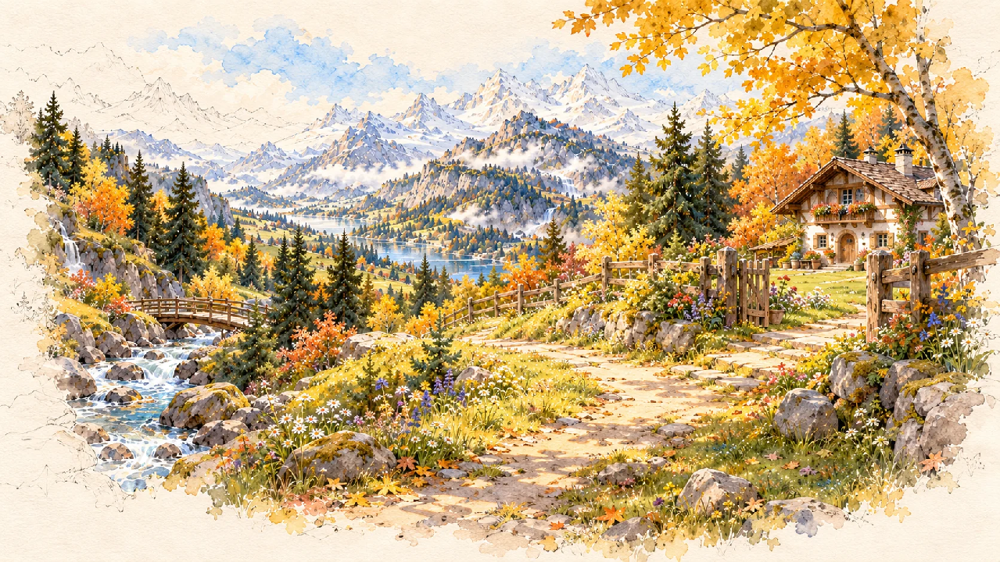
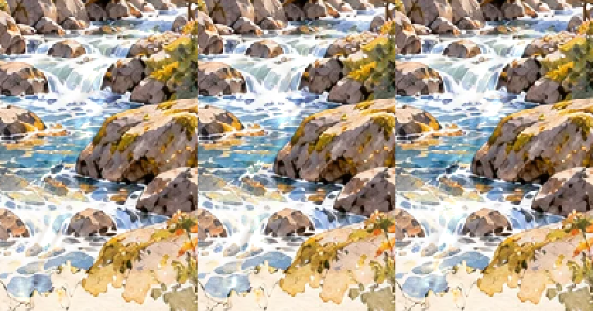

# 溪流804的隔离真实GPU阶段核对

CODEX-LEAD，2026-10-16；源PR804 / 完整2e03211f3e3f850b27f7d8236b10ce5e7fe13e41，阶段审核5540919782。仍是候选，未将art或Shader接到生产，#749开放。只归档真实GPU/原件，不将转述用户回执补造为本会话直接验收。

从精确SHA取得15个预览文件，逐Git blob核验。Godot4.7.2/OpenGL3.3/NVIDIA RTX4070，导入、原驱动暂停/低动效自检、phase0/10/20/40及390×844窗口退出0，无错误。Git archive首次因缺blob长时间无进展、随后空包读取失败，改从精确raw URL并逐blob核对成功；没有因此改候选源码。父工程/主游戏/存档未触碰。

GPU横幅内容实际1279×720（窗口1280×720）；半圈4155变化像素，bbox158–272/428–633，水面外及桥/石保护区差0；整圈0→40逐像素相同。原图0/20/40、原日志和像素统计保留，0与40同blob去重。水彩底板/桥石稳定，主/次级亮带路线允许继续隔离验证，非生产通过。contact只并排三个实际GPU采样作观察，不是连续录像。

390×844是实际桌面窗口，但get_viewport纹理截图只有390×219横幅内容；不能把gpu-portrait.png称完整竖屏画面、设备或触屏体验。还需连续GPU样片、真实宿主天气/低动效/照片/性能。Owner可继续遮罩、低动效静帧契约和资源成本，Leader接宿主验证，不需要等待用户重复特定措辞；未回执不称已接收。
