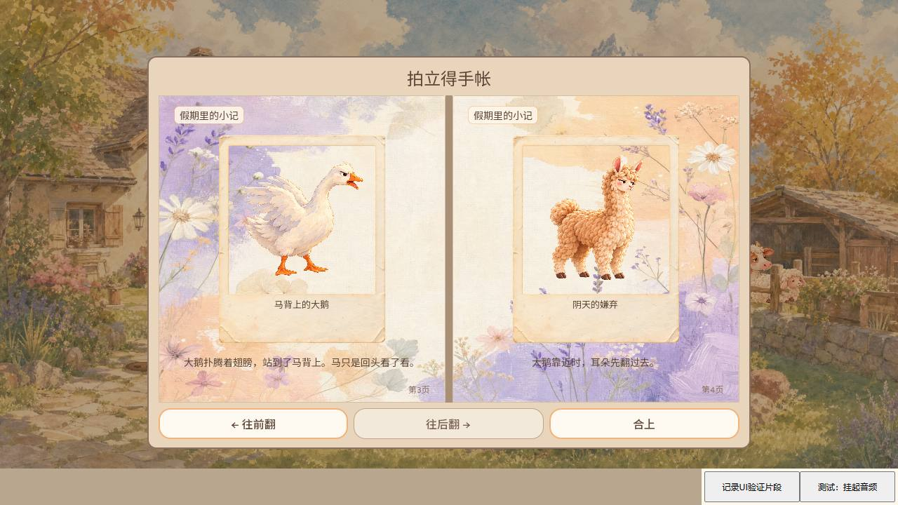

# #704 获批 UI 短音：当前主线集成与 Web 输出

Owner / 审核人 CODEX-LEAD；原作者 GROK-CONTRIBUTOR。PR720 原头 `3e9bf647041dffd254bab5f16a532fec730294eb` 的完整祖先保留在 PR810 集成 `c71972e9cc7cdbcbe05b26df1c0da42d8eae246d`；当前运行返修 `ab26805fef668c030236b021776cf374f4bc47d3`，树 `ccc797f79d01fbf62df43eaffbd617e7e8311873`。主线基线 `84d7132d59d42e3c34496bd9bc6c7cc9790879fa`。

本页是候选验证，合入、CI及公开发布另按原PR实时回执；不是“已经上线”。没有新玩法、存档格式或成长数值变化。08/09/10仍为[用户已批准的锁定文件](../../audio/hearing-2026-10-12.md)，完整三份SHA256见 verification.json；13/14/15保持禁播。

## 变更与实测结果

两个文本冲突仅在AudioDirector cue表及daily完成清单，均保留双方增量；Main自动合并后逐方法复核，保留做饭、磨粉、公告与焦点行为。缺件无未批准tone替代、70ms防抖、幂等隐藏及无效翻页无提示保持。

初轮正常Chrome中，Godot sample源非零，关闭背景声后的一个关闭提示目的端为0；该次源及输出观测与后续返修分别记录，不宣称所有平台的单一根因。返修只让三个UI cue选择已有BrowserBgmPlayer；暂停保留UI提示，自动游戏SFX仍停，主静音/后台规则沿用共享后端。未更改批准源波形或增加平行播放器。

Godot4.7.2本机最终代码：原音频29、真实viewport输入61、音景生命周期87、环境输出上限30、做饭宿主71、做饭叶子107项完成且无错误。初始集成另完成音量按钮648、暂停提示168、菜单键盘207、公告焦点136、拾物96项；这些旧运行不伪称在返修头重复。完整CI以PR810最终适用记录为准。

独立Chrome155桌面1280×720自动化驱动退出0，27项通过，pageerror 0：

- 背篓/相册鼠标打开、Esc关闭、暂停/继续分别恰好一个源，实际目的端非零；打开峰值约0.117、关闭约0.108，空闲背景已关。
- 空相册及四照片夹具的首/末页边界0源/0输出；有效翻页一次源，目的端峰值约0.099。四照片由卸载游戏后的独立测试档、生产envelope/submit流程准备，不称普通摄影获得。
- 主静音后开关均0源/0输出，解除静音与空闲不补播；下一真实操作才播放。
- 明确标记的受控AudioContext suspend后，第一次可信输入恢复权限但当次cue被丢弃，随后不补播；再关闭有正常输出。没有假称首个恢复手势必然发声。

390×844桌面Chrome触屏模拟另保存7项记录：背篓开/关、相册开/无效页/合上、暂停/继续，分别符合次数及实际输出；不是实体手机。七项写入后，最后一次工具调用在完整probe读取/清理阶段超时，原始调用不记exit0；本页独立校验七份落盘记录通过，详情 raw/mobile-post-run-limitation.txt。

早期交互式观察器按钮夺走焦点，导致数份键盘样本不可用，已单列在raw/web-earlier-checks.json.gz；最终桌面驱动使用只读观察器，不靠测量按钮抢焦点。一次手写命令误用了不存在的audio_director_lifecycle_suite，已改跑真实yard_audio入口；该命令失败不抹去，也不算产品缺陷或测试通过。

## 截图与原件

raw中包含桌面27项、竖屏7项、真实输出时间序列gzip、受控档前后envelope、原生日志与导入/导出日志。verification.json绑定本地PCK完整字节与哈希；本包未加正式发布身份，不能冒作公开包。没有人耳/硬件出声、实体手机或完整成长验收声明。

## 重现

在该运行SHA以Godot4.7.2导入并导出Web，按生产壳复制web目录至导出目录，HTTP端口8174。仅在测试HTTP响应的head前加载observer.js，游戏脚本/PCK不修改。使用自有隔离Chrome上下文，安装playwright后 `node web-check.cjs <证据输出目录>`；可用PLAYWRIGHT_MODULE/CHROME_PATH指定现有运行库和Chrome。该驱动固定1280×720，控制鼠标/键盘而非调用Main私有动作；受控四照片准备已在脚本明示。观察器只旁路测量AudioNode输出与记录源，不代放声音或改存档；照片夹具是另一个显式测试步骤。

## 完整CI首次失败及修订

[CI38787599051](https://github.com/narutojzm1-dot/youjia/actions/runs/38787599051) 在做饭叶子4/107失败，原始尾日志保留。旧断言禁止所有UI选择Web后端，检查时创建的UI通道又污染后续空池断言；本次没有删掉做饭停止/释放/缺件检查。修订 `70601abfa45975cd4eb84d66a0466e2de964634a` 只改两套测试：改验UI独立总线并清理检查通道，新增真实adapter的暂停保留UI/停止做饭SFX/后台停止UI/返回不补播，61及107项本机通过。相对ab运行头生产文件未变，前述Web证据继续适用。完整新CI未通过前不合入。
