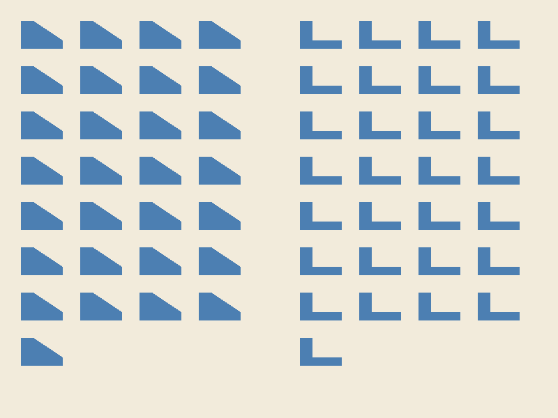
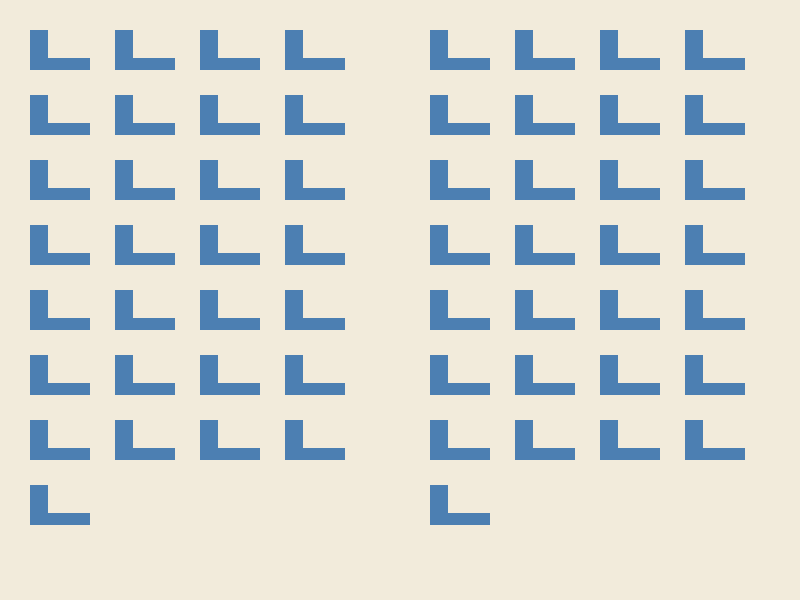

# 回院 WebGL 索引更新修复候选

Agent-ID: CODEX-LEAD。原单 #535，相关音景候选 PR813；不改变其声音听验与手机门禁。本记录是可重复的图形缺陷与导出修复，尚不表示已公开发布，也不宣称解释了此前所有长开标签页停绘制。

## 定位与实际画面

上一轮 PR819 已把问题缩到：正式492与音景候选4f8同路线回院均有58条警告，29个不同索引Buffer随后被绑到ARRAY_BUFFER。本轮独立工程只使用29个Polygon2D，没有音频、近郊宿主或存档；隐藏再显示以及更新多边形都产生同一WASM调用栈。

固定官方4.7.2 / ed1daf0bf单线程release模板中，函数67027（文件偏移33047519、344字节）的错误分支直接引用内存字符串 `mesh_surface_update_index_region` 与 `drivers/gles3/storage/mesh_storage.cpp`，不是仅凭函数顺序猜测符号。对应[官方源码](https://github.com/godotengine/godot/blob/ed1daf0bf/drivers/gles3/storage/mesh_storage.cpp)的索引更新使用三次ARRAY_BUFFER；WebGL2不允许已作为元素索引的Buffer改绑为其他数据类型，COPY_WRITE_BUFFER则允许两类Buffer并且不会修改VAO的元素绑定，见[WebGL2缓冲对象规则](https://registry.khronos.org/webgl/specs/2.0/#BUFFER_OBJECT_BINDING)。

对照工程左侧更新已有六顶点凹多边形，右侧重建相同新形状。两边整幅400×600比较，不忽略边缘或错误日志。Chrome155 / ANGLE Intel Arc D3D11，实际800×600；不是RTX4070或实体手机。

| 同一PCK/JS、仅WASM不同 | INVALID_OPERATION | 左右不同像素 | 最大通道差 | 浏览器WASM验证 |
| --- | ---: | ---: | ---: | --- |
| 官方原版 | 116 | 17,052 | 166 | 通过 |
| 索引更新修复 | 0 | 0 | 0 | 通过 |

两个浏览器运行均无pageerror。原件PNG、完整console记录的无损压缩、逐文件哈希与独立工程/浏览器驱动随本记录保留。压缩记录可用Python标准库 `gzip.decompress(base64.b64decode(...))` 还原，按 `identities.json` 校验；没有重画或缩放截图。早期29个四边形生命周期记录只用于调用栈定位，不冒作上述凹多边形画面对照。

## 修复范围与拒绝条件

`tools/repair_web_index_buffer.py` 对导出的WASM做受限修复：函数内三个 `i32.const GL_ARRAY_BUFFER` 改为 `i32.const GL_COPY_WRITE_BUFFER`，即绑定、写入、解绑三处。指令长度相同，实际6字节不同；所有其他指令、检查、数据、函数编号和文件长度不变。不是浏览器拦截/替换Buffer，不读取或清空GL错误，也不隐藏console。官方模板与本机模板目录不修改。

- 原始WASM SHA256：`fc74679e3b97f76878947fcd4fbe1268cbfa6188182a2e33bbc3f5dc9bfa57d0`。
- 原函数SHA256：`c0779bd094d8caeae344bda5ef35a9470a05be009ade6647c1b4f45d5bae166c`。
- 修复WASM SHA256：`fdab8cf15509d9042cd7f6f9f9eafb5201c85a59ed161d91346046b2a9268fe4`。
- 同一修复重复执行幂等；未知版本、截断或任意字节损坏拒绝，升级模板必须重新定位与实核，不按相似字节搜索替换。
- Verify/Publish均在真实导出后验证原模板、修复，再进入原有发布。发布器拒绝已知未修复模板，按修复后实际哈希生成新的engine URL，并在公开manifest的engineAssets.repairs记来源/修复身份；不重用旧引擎缓存名。
- PCK业务、保存schema/FIFO、近郊Owner文件、正式资源与音频未修改；公告独立标明局部图形修复与旧停绘制根因仍未穷尽。

## 复现与门禁

1. 把 `test/webgl_index_buffer/` 复制到临时目录，用同版Web模板导出独立工程。原版及修复版使用同一PCK/JS，仅对后一份执行 `python3 tools/repair_web_index_buffer.py path/to/index.wasm`。
2. 本机HTTP服务分别提供原版/修正版，运行 `PLAYWRIGHT_MODULE=... CHROME=... node test/webgl_index_buffer/run_browser.cjs URL OUTPUT_DIR`；驱动只连接自己新建的隔离Chrome，不接用户浏览器或游戏存档。
3. 真实导出后先运行 `python3 test/web_index_buffer_repair_test.py dist/index.wasm`，核对原模板、精确字节差、重复修复和5种拒绝情形，再运行修复命令。没有在仓库提交39MB引擎副本或新第三方依赖。

普通游戏的同路线回院、睡眠、后台、静音和保存恢复另在原PR逐项留结果；本最小工程通过不替代这些运行检查、完整CI或公开manifest/实际引擎/PCK核验。PR813仍保持原听感/设备未覆盖边界，未因为此项解除所有门禁。
