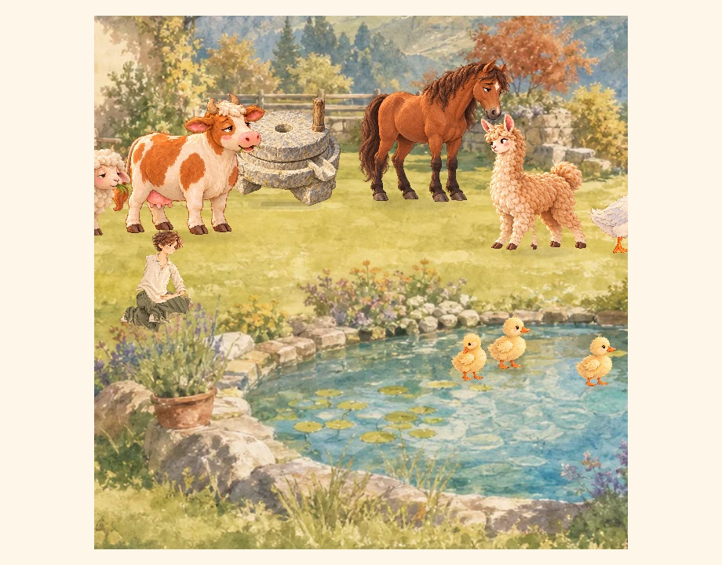

# #700 园艺专属接触表现（CODEX-LEAD，2026-10-18）

基线61395bb4a07bc6a3f1f3702d88538ffb63e21f27。新增播种专属刚性画层动作：固定脚位下蹲、一手扶种一手撒种、双手覆土、起身。只改表现及工位精度，不改已公开花种/AP/XP/开花日数/FIFO事务，不新增经验等级或食谱。现有素材原像素未改，无新纹理/照片字段/写端版本。

## 已完成的适用验证

- 最终原生garden_pose92项：真实World/导演、全过程脚位、实际花畦掌心、手持种包、暂停/低动效/玩家接管、确认前不扣料、不预显花畦、同笔确认及Native重读。
- GPU103项及10个阶段画面，NVIDIA RTX5090D v2。图中的两倍近景是实际Viewport变换，阶段由隔离夹具显式取样，不冒充普通Web连续操作。
- 既有园艺46、磨粉姿势35、灶台姿势32、取草61、照片48、手持照片39、公告102/136检查通过。
- 实际旧公开game-73c41fa完整PCK（92451968B，SHA256 8468bc564e8e9353ddf6a7cd172102340d36b6127424689ba09baa917ac4ea70），在无源码的空读取目录加载，新动作照片31项及所有JSON字段精确保持，并以旧PhotoMoment实际绘制。无需再次升Web存储版本。旧照片只指本次明确样本，不扩大为所有历史任意客户端保证。

首轮足端夹具检查暴露站姿端点0.005单位余量，已修正腿部求解；首轮照片断言误将同一player subject的已公开种包当作衣装，修订为分开检查现有种包与11个人物画层。失败日志原件保留。完整CI、普通Web、实际公共包与发布核验尚待接续；不能凭本记录称已上线、完整成长树或实体手机已验收。

